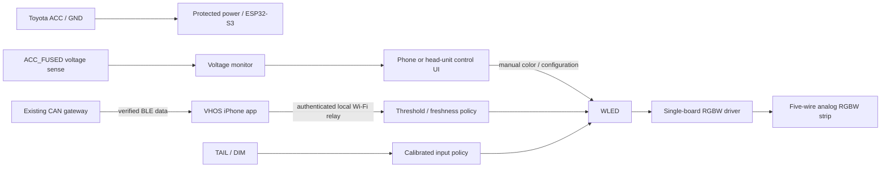

# 4Runner RGBW workspace: WLED, wireless CAN and Toyota inputs

Working load assumption: BTF-LIGHTING nominal-12-V analog five-wire RGBW in an IP67 sleeve, as recorded in the [marketplace guide](../../hardware/console-led-node-v0.1/pcb-rgbw-revh/strips/MARKETPLACE.md). No exact strip length has passed the voltage/current/thermal/sealing tests. The existing power output is protected vehicle voltage, not regulated 12 V; software dimming cannot qualify an oversized strip. The 0.5 A/channel and 1 A combined electrical screen remains in force.

## Configuration and wiring

The cavity assignments below are the current design map. Actual truck circuits, polarity and connector orientation still require vehicle verification.

| Function | Connection / behavior |
|---|---|
| Sole power source | Toyota cavity 6 → JT1-2 ACC; cavity 5 → JT1-1 GND. All six cavities retain one-to-one harness pass-through. |
| TAIL | Cavity 1 → JT2-1 → protected sensing path → GPIO5. Optional calibrated gate, disabled by default. |
| DIM | Cavity 2 → JT2-2 → protected sensing path → GPIO4. Optional measured brightness scaling, disabled by default. |
| Reserved wires | Cavities 3 and 4 terminate at isolated JT3 pads. They do not connect to GPIO or power. |
| Supply monitor, Rev I | ACC_FUSED after F1 → third protected U5 switch channel → GPIO1 ADC. No external connector or extra supply. |
| RGBW returns | JT4-1/R GPIO18; JT4-2/G GPIO17; JT5-1/B GPIO14; JT6-1/W GPIO2. |
| Strip common positive | JT5-2. JT6-2 stays empty. |
| Driver enable | GPIO21, low at initialization, lost readiness and zero effective output. |
| WLED bus | One TYPE_ANALOG_4CH bus, numeric type 44, one logical pixel, R/G/B/W pins 18/17/14/2. Whole-strip color, not individual-pixel chasing. |
| Private Wi-Fi | Controller AP 4Runner-Lighting at 192.168.88.1. Set a new password of at least 12 characters and a unique 16–64-character printable non-space relay key. |

ACC is switched. Losing it removes power; the controller cannot keep measuring the resting battery or running after shutdown. Supply sensing measures the feed at the box after F1, with harness/fuse drop; it is not a battery-post measurement. The voltage screen and two-point calibration are separate from automotive pulse qualification.

## Software path and control priority

1. At boot, output intent starts off. There is no saved automatic session or auto-on preset.
2. Arming plus the expected PWM bus and an isolated secured AP with a client makes the controller ready. Calibration cannot arm it.
3. A manual color takes over from a CAN rule. WLED's normal manual color/preset controls retain their existing takeover hook.
4. A CAN rule starts explicitly from VHOS. Accepted samples must match the active session and selected signal, with increasing sequence and a valid range. Duplicate, malformed or wrong-session samples do not refresh the deadline.
5. An accepted sample at/above the on threshold enters; the off threshold supplies hysteresis. After 2.5 seconds without a fresh accepted sample, automatic output is off.
6. TAIL gating and DIM scaling affect both manual and automatic output. Their ADC calibration is never inferred from a wire label. TAIL uses at least 50 mV hysteresis and 200 ms stable-state debounce; DIM requires at least 100 mV span. Input freshness expires after 250 ms in the policy. These are engineering policy values, not Toyota service specifications.
7. Changing a rule or cabin calibration stops the automatic session. Restart the VHOS relay after applying settings. The main firmware loop schedules configuration persistence through WLED; HTTP 202 acknowledges application in RAM, not proof of a successful flash write.

The BTF strip remains an evaluation load; the retained firmware also has a 25% per-channel PWM duty ceiling. That ceiling is not an instantaneous-current limiter. There is no inferred battery-health verdict, charging-system diagnosis or automatic low-battery shutdown threshold.

## UI/UX

Open **http://192.168.88.1/vhos/ui** on the head-unit browser. VHOS iOS now embeds that same controller-hosted UI inside System → 4Runner lighting, allowing its foreground BLE-to-Wi-Fi relay to continue while switching between controls and the native CAN-relay panel.

- **Lights:** editable RGB swatches/custom color, independent white and requested brightness; explicit Apply and Off; a labeled local color preview; controller-applied level and mode; real connected/disconnected status.
- **Automations:** one signal and threshold rule with user-selected color. RPM, vehicle speed, coolant temperature and calculated load require fresh supported J1979 responses from the current gateway session. Passive CAN activity is available only from actual current verified frames. Unsupported or ambiguous readings remain waiting; no Toyota CAN IDs or scaling are guessed.
- **Wiring & setup:** all six Toyota wires, RGBW terminals, first-power instructions, measured TAIL/DIM settings and the Rev I two-point supply calibration.
- **Disconnected:** all hardware actions remain disabled and voltage stays unavailable. Local swatch previews still work and are explicitly previews. There are no generated dashboard telemetry values.

The iPhone relay is foreground-bound and stops when the lighting view disappears or the app backgrounds. The Android browser supplies manual control/configuration; it does not implement a standalone gateway relay. For continuous CAN-driven lights without the phone, a resident head-unit relay is still required. This implementation does not claim one.

## Local API additions

All accessory requests use X-VHOS-Key. No accessory endpoint transmits on CAN.

| Route | Meaning |
|---|---|
| GET /vhos/status | vhos.lighting.status@1.0.0: configuration, readiness, relay freshness, ADC samples, requested/effective level and source-labeled supply measurement. No relay key is returned. |
| POST /vhos/manual | action=set plus red/green/blue/white/brightness, integers 0–255; action=off clears intent, including while disarmed. |
| POST /vhos/config | Complete atomic rule and cabin configuration. Bad fields or invalid calibration reject without partial changes. Does not set a relay key or arm the hardware. |
| POST /vhos/voltage | low-adc-mv, low-input-mv, high-adc-mv, high-input-mv. Requires the Rev I build and two separated bench measurements. |
| POST /vhos/lighting | Existing start/sample/stop relay protocol remains compatible with VHOS. |

The UI uses no CDN, cloud service, external font or hosted account. Its editable HTML/CSS/JS is deterministically embedded as gzip in ESP32 flash. The iOS web view is ephemeral, limits navigation to the controller origin and keeps the relay key in view memory. No commissioning credentials are committed.

## Build and verification

WLED remains pinned to v16.0.1 / 29b389df1c1aaec6ff53aea742d17063b985906c. The Rev I image uses vhos_revi_n16r2 with VHOS_SUPPLY_SENSE. The original vhos_revg_n16r2 target retains no voltage input and can build the UI for Rev G/H. Do not flash the Rev I sense image to an unmodified Rev H board and treat a floating GPIO as a measurement.

The native [Orion firmware receipt](builds/revi-strip-ui-02/firmware-build.json) records exact images and usermod hashes. This is a cross-compile, not a flashed-device or vehicle pass. Actual driver/ADC/PWM, incoming power transients, strip current/temperature, end sealing and phone/head-unit pairing require the documented physical acceptance. See [Rev I hardware](../../hardware/console-led-node-v0.1/pcb-rgbw-revi/README.md).

References: [WLED analog-strip compatibility](https://kno.wled.ge/basics/compatible-led-strips/), [WLED local JSON API](https://kno.wled.ge/interfaces/json-api/). The custom routes above are project-owned additions, not claims about unmodified upstream WLED.

Voltage calibration accepts 6–17 V bench references, requires separated readings and a transfer reasonably consistent with the divider. ADC values above 1200 mV are reported over-range with no numeric voltage, keeping the display clear of the clamp region. This range is a measurement policy, not a Toyota battery-health threshold.
