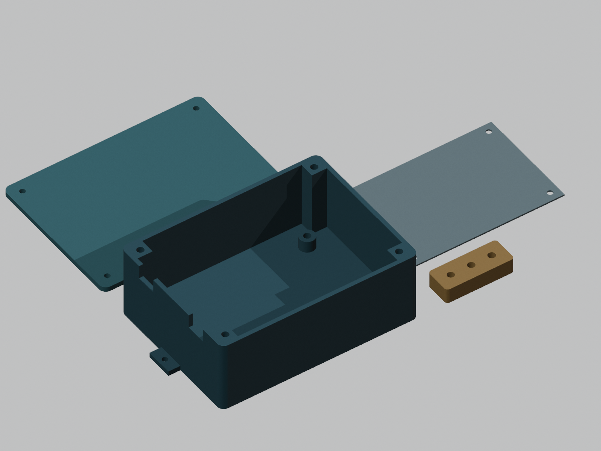
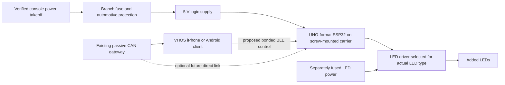

# 2005 V8 4Runner console LED node — research and fit-check case

Status: **connector identification pending; electrical design pending; case is a dimensional prototype**.
Owner task: 2026-11-07. No parts ordered, functional PCB fabricated, vehicle wiring changed, or printer started.

The requested system is feasible: the existing CAN gateway supplies telemetry,
an added ESP32 receives selected validated values, and a protected output stage
drives added LEDs. The console harness supplies power and possibly discrete
lighting/switch signals. Its exact cavities and functions are not established
by these side/rear photographs. A connector breakout cannot expose vehicle
data that is absent from that connector.

## What the photographs establish

| Location in both photographs | Observation and working identification | Confidence / remaining check |
| --- | --- | --- |
| Black cylindrical component at upper left | Rear of a cigarette-lighter / 12 V socket assembly | Strong visual identification; distinguish the actual socket variant by its label and front view |
| Beige connector beside that socket | Part of the local socket/illumination wiring | Function inferred from its physical routing; cavity count, mating face and part number unreadable |
| Loose white multi-pin plug at lower left | Console sub-harness connector; Toyota **IR1**, the cigarette-lighter wiring assembly junction, is a candidate | **Unconfirmed**; photos do not establish cavity count or numbering. Do not buy a six-way connector from this inference |
| Blue connector in black switch housing at right | A console switch connection | Exact switch unidentified without its front legend; no assertion that it is DAC, differential lock or another trim-specific function |

Toyota's reproduced EWD identifies IR1 as the join between instrument-panel
wiring and the cigarette-lighter wiring assembly. It separately lists C6
lighter housing **90980-10760** and C7 illumination housing **90980-11148**.
These are catalog references, **not confirmed matches to the photographed
white plug**. The accessible EWD references cover a range of model years;
exact 2005 V8/build-month applicability and connector views still need checking
against the vehicle. [Toyota EWD connector-location page][ewd-ground],
[connector list][ewd-connectors], [Toyota TIS][tis].

The manufacturer's actual mating face and cavities must match before purchase.
Wire color, connector color, a model-wide fitment list, or a housing number
alone does not establish the mating half. There is no verified all-pin
Toyota-to-PCB adapter in this package.

## Parts that can be sourced

The complete candidate list, quantities and unresolved selection conditions are
in [BOM.csv](BOM.csv). All electronic parts are research candidates, not a
released fabrication BOM.

| Item | Concrete lead | What it establishes |
| --- | --- | --- |
| Console wiring assembly | **Toyota 82390-35010** | Dealer calls it Bulb Wire / Wiring Assembly Cigaret, center console. ToyotaPartsDeal lists 4.7 L 2UZ-FE compatibility. It may be only part of the lamp/socket loom; terminal population and both ends require a real product photo. [Dealer listing][toyota-harness], [secondary availability][harness-sale] |
| OEM socket housing | **Toyota 90980-10760** | Female housing cataloged for the lighter; not the identified mate for the loose multi-pin plug. Secondary listing currently says unavailable. [Listing][socket-housing] |
| Locking PCB connector | **Molex 43045-0600** | Six-circuit, 3 mm pitch, right-angle through-hole Micro-Fit header with PCB retention. [Manufacturer][molex-header] |
| Matching cable housing / contacts | **43025-0600 + 43030-0007** | Matching Micro-Fit family, 20–24 AWG tin socket contacts; verify insulation OD ≤1.85 mm and use the proper crimp tool. This pair fits our PCB, not Toyota's loom directly. [Housing][molex-housing], [contacts][molex-contact], [family mating catalog][molex-family] |
| Protected 5 V supply | **LM5164-Q1** | 6–100 V input, 1 A buck candidate for controller/logic. Supporting components, thermal behavior and cranking recovery remain design work. [TI][buck] |
| Reverse-battery protection | **LM74700-Q1 + suitable external N-FET** | Ideal-diode controller candidate, not a complete load-dump solution. Clamp, surge energy, FET and fuse must be designed together. [TI][ideal-diode] |
| Addressable LED data option | **SN74AHCT125-Q1** | 5 V buffer with TTL-compatible input; a possible 3.3-to-5 V data stage, not an LED power supply. [TI][level-shifter] |
| 12 V analog RGB option | **UCC27524A-Q1 + BUK9K12-60E** | Gate-driver and dual 60 V N-FET candidates; a three-channel RGB load needs enough channels, separate fusing and a reviewed thermal/current design. [TI][gate-driver], [Nexperia][mosfet] |
| Printed-case hardware | **8 × ruthex RX-M3x5.7**, **4 × M3x8**, **4 × M3x6 + insulating washers** | Case/own-carrier mounting only; not verified UNO mounting holes. [Insert manufacturer][inserts] |

Observed quotations on the research date: the Toyota wiring assembly was
$20.78 at Olathe and $14.86 with a stated 1–3 business day dispatch at
ToyotaPartsDeal. These are page observations, excluding delivery/tax and
subject to seller/VIN confirmation. No purchase has been placed.

## Electrical and mechanical arrangement

Use an OEM mating **pass-through T-harness** if the existing socket is to keep
working. Preserve its original circuit and current capacity through the loom;
take only the new fused branch into our PCB. A short pigtail, locking PCB
header and strain relief let the case support insertion forces. The vehicle
plug does not support the PCB's weight. A direct Toyota PCB header would be
an alternative only if its exact mate, retention, drawing and availability
are established.

The UNO-shaped controller previously referenced in this workspace is a likely
**DIYables ESP32-S3-WROOM-1-N16R8**, still unverified against the owned revision.
Its published approximate outline is 68 × 53 mm and it supports Wi-Fi and BLE.
The published pin mapping is not an AVR UNO electrical pinout: the listing
even marks IOREF as 5 V while ESP32-S3 GPIO is a 3.3 V domain. Do not attach a
5 V UNO shield or raw vehicle wiring on the strength of its shape. [DIYables][board],
[Espressif hardware guidance][esp-guidance].

The existing VHOS repository already preserves raw observations and signal
quality. Its README reports zero accepted target-specific passive-CAN signals
for the hypothesis pack. Do not turn candidate CAN bytes into RPM, temperature,
door-state or fault claims. Standard OBD responses also require actual
per-ECU supported-PID evidence. This package adds no firmware, signal decoding,
CAN transmission, vehicle actuation or app control service.

For a first implementation, the existing iPhone/head-unit client can read the
gateway and send bounded LED commands to a second BLE peripheral. That link is
**proposed, not implemented**. A direct ESP32-to-gateway link needs the gateway's
actual service/connection capacity and radio coexistence validated; a second
BLE client cannot be assumed to coexist with the current app. iOS uses BLE,
not an assumed classic Bluetooth serial connection. Wi-Fi requires an explicit
local session; do not turn on the existing default-off gateway SoftAP silently.

Only fresh, validated measurements may drive a configured rule. Boot,
disconnection, stale or invalid data must set a documented safe LED state;
unknown must not mean “zero” or a green vehicle-health indication. Use hardware
default-off output enables and gate pulldowns. Keep factory exterior lighting,
airbag, braking and drivetrain-control wiring outside this added-light node.

## Printable fit-check package

The original case body is **116 × 86 × 42 mm**, plus a 3 mm lid; mounting ears
increase the overall width to **130 mm**. It has 2.4 mm walls, a 3 mm floor,
four lid screws, four custom-carrier posts, two open-top 12 × 8 mm cable slots
and two integral tie bridges. This is an unsealed cabin enclosure concept.

The proposed custom carrier is **90 × 62 × 1.6 mm**, with an **80 × 52 mm**
mount-hole rectangle. Its interface is our design, not a measured UNO hole
pattern. The separate controller envelope **72 × 57 × 25 mm** is an informed
estimate and leaves 5.4 mm nominal ceiling space; it does not prove clearance
for the actual shield, USB plugs, wiring or the RF antenna. No functional KiCad
board or Gerbers are supplied.

Download/inspect these files under [cad/](cad/):

- `case_base.stl` and `case_lid.stl`: unpowered fit-check parts.
- `insert_coupon.stl`: pilots of 4.0, 4.1 and 4.2 mm, left to right along X.
- `carrier_drill_template.stl`: 1 mm plastic template for our proposed carrier.
- Matching STEP files and `console_led_fitcheck.FCStd`: native geometry.
- `carrier_REFERENCE_ONLY.step` and `controller_ESTIMATED_KEEP_OUT.step`: sizing
  references, not printable electronics or evidence of owned-part fit.

[READ_BEFORE_PRINT.md](READ_BEFORE_PRINT.md) records orientation, hardware,
service sequence and the outstanding print/vehicle measurements.
[mechanical-contract.json](mechanical-contract.json) records the mating and
load-path assumptions. The paired parts come from one source-pinned generator.

Orion job `mdl_167661df00514363` exported and reopened the actual STEP solids,
checked closed STL meshes, and found no volumetric intersection between the
case, lid and **estimated** carrier/controller envelopes. The four printable
parts were valid single solids. See [CAD observations](cad/cad_observation.json)
and [hash manifest](cad/manifest.json). These checks do not establish physical
fit, thermal suitability, RF performance, EMC, fatigue, creep or sealing.

The existing main Orion discovery endpoint returned an unrelated stale Cura
snapshot error involving `cura.log`. CAD was completed through a temporary,
authenticated, single-job Orion controller; the installed service was not
modified or restarted. Slicing/printing was not attempted with that stale
profile. No cloud compute or GitHub Actions was used.

## Information needed to finish the actual PCB and installation

1. Confirm which photographed plug is the target. Retain a straight-on mating
   face photo with latch orientation, a rear-wire photo and every molded number.
   Count cavities, including empty ones. A scale/caliper measurement is needed
   for any connector retention bracket.
2. Confirm the owned ESP32 maker/revision and both faces; measure board, holes,
   header stack, USB access and antenna position. The earlier A/C board and this
   cabin light node are distinct projects.
3. Identify the actual LEDs: new accent/indicator lights or factory lights,
   5 V addressable / 12 V addressable / analog RGB, exact part, length and peak
   load. Select the driver, supply, fuse and connector only after that load is known.
4. Record exact 2005 V8/VIN build/trim wiring and meter evidence for the chosen
   feed/ground. Keep every unknown cavity unconnected. Do not bridge unknown
   pins or assume illumination return is chassis ground. Qualified testing
   should compare OFF/ACC/ON and lighting/dimmer states with a high-impedance
   meter; no powered-circuit resistance tests or test-lamp probing of bus/SRS.
5. Measure the proposed console space, mounting surface and cable extraction
   path, verify current printer/material/profile, and fit the coupon first.
   Then complete the populated PCB/connector model, schematic, protection and
   thermal calculations, ERC/DRC and bench bring-up before vehicle power.

[ewd-ground]: https://diagnostdata.com/toyota/4runner/iv-facelift-2005-2009/remont/body-electrical/oem-ground-points/wiring/
[ewd-connectors]: https://diagnostdata.com/toyota/4runner/iv-facelift-2005-2009/remont/body-electrical/oem-part-number-of-connectors/oem-part-number-of-connectors/
[tis]: https://techinfo.toyota.com/techInfoPortal/appmanager/t3/ti?_nfpb=true&_pageLabel=ti_toy_lib_content
[toyota-harness]: https://parts.olathetoyota.com/oem-parts/toyota-bulb-wire-8239035010
[harness-sale]: https://www.toyotapartsdeal.com/oem/toyota~wire~cigarette~lighter~82390-35010.html
[socket-housing]: https://www.toyotapartsdeal.com/oem/toyota~housing~connector~f~90980-10760.html
[molex-header]: https://www.molex.com/en-us/products/part-detail/430450600
[molex-housing]: https://www.molex.com/en-us/products/part-detail/430250600
[molex-contact]: https://www.molex.com/en-us/products/part-detail/430300007
[molex-family]: https://www.mouser.com/pdfDocs/987650-3951.pdf
[buck]: https://www.ti.com/product/LM5164-Q1
[ideal-diode]: https://www.ti.com/product/LM74700-Q1
[level-shifter]: https://www.ti.com/product/SN74AHCT125-Q1
[gate-driver]: https://www.ti.com/product/UCC27524A-Q1
[mosfet]: https://www.nexperia.com/product/BUK9K12-60E
[inserts]: https://www.ruthex.de/products/ruthex-gewindeeinsatz-m3-100-stuck-rx-m3x5-7-messing-gewindebuchsen
[board]: https://diyables.io/products/esp32-s3-development-board-with-esp32-s3-wroom-1-n16r8-wifi-bluetooth-uno-compatible-form-factor-works-with-arduino-ide
[esp-guidance]: https://docs.espressif.com/projects/esp-hardware-design-guidelines/en/latest/esp32s3/schematic-checklist.html
