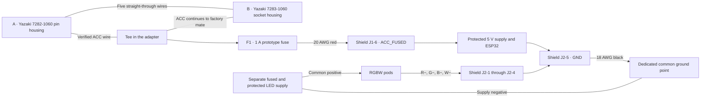

# 2005 4Runner V8 inline harness for the RGBW shield

Build sheet for the ShengYang D1 UNO ESP32-S3 and the [RGBW Rev A shield](../pcb-rgbw-reva/README.md).
The two Toyota housings carry six straight-through circuits. A fused branch
takes switched power to the shield through a detachable plug. The shield
returns current through its dedicated ground lead. Connector fit and the
vehicle's power source still need physical verification.

## Wiring

**A** mates with the pictured white factory socket. Its six-contact face,
with two outer cavities above four across and a centered latch, matches the
Yazaki 7283-1060 pattern in the supplied comparison. **B** mates with the
original factory pin housing if present. Dry-fit both latches and confirm that
the original halves pair with one another before inserting the adapter.
[Yazaki pin housing](https://connector.yazaki-group.com/cgi-bin/english/detail.cgi?part_id=7282-1060),
[Yazaki socket housing](https://connector.yazaki-group.com/cgi-bin/english/detail.cgi?part_id=7283-1060).

| A pin cavity | B socket cavity | Branch to the shield |
| --- | --- | --- |
| 1 | 1 | Pass-through. |
| 2 | 2 | Pass-through. |
| 3 | 3 | Pass-through. |
| 4 | 4 | Pass-through. |
| 5 | 5 | Pass-through. |
| 6 | 6 | Pass-through. Candidate for the ACC tee if verified on this truck. |

Use the molded cavity IDs and check the physical pairing and continuity. The
mating faces appear mirrored when both are pointed at you. Label both ends of
each wire before crimping. Match the factory conductor size for every original
path and keep the original fuses in service. The added branch uses some of the
upstream circuit's available current.

The 2006 Toyota diagram shows IR1 cavity 6 (pink/blue) on the CIG feed. The
April 2005 owner’s manual for the target model lists the 10 A CIG position as
unused and lists the 15 A PWR OUTLET fuse for the outlets. Verify the source
before cutting any tee. With the shield disconnected, measure the proposed
feed against a verified chassis ground with a high-impedance meter in OFF,
ACC and ON. Repeat with the lamps off and on, and confirm the source fuse.
Use the verified switched positive conductor for the tee. If the white plug
has no factory mate or no verified switched feed, leave the six-way wiring
passive. The same F1-to-J1 pigtail can take power from a verified switched
outlet feed using a matching outlet adapter.
[Toyota 2005 owner’s manual, p. 408](https://assets.sia.toyota.com/publications/en/om-s/OM35860U/pdf/OM35860U.pdf#page=418),
[Toyota 2006 EWD, p. 296](https://www.datacar-manualrepair.com/wp-content/uploads/2018/09/Diagrama-el%C3%A9ctrico-Toyota-4Runner-2006.pdf#page=340).

### Shield cable terminations

| Cable position | Connection |
| --- | --- |
| J1-6 | F1 output, verified switched positive. |
| J1-1 through J1-5 | Empty. All six Toyota circuits stay in the inline loom. |
| J2-5 | One dedicated wire to the common ground point shared with the LED supply negative. This returns controller current during logic-only testing as well. |
| J2-1 through J2-4 | R−, G−, B−, W− after verifying the pod harness. Leave empty for the logic-only test. |

Rev A ties J1-5, J2-5 and the ESP32 ground together on the PCB. Leaving J1-5
empty keeps LED return current out of the factory console wiring if the
dedicated ground lead opens. Use J2-5 as the shield's sole vehicle return and
keep USB disconnected in vehicle operation. The four switched negatives go to
the pods and the common positive goes directly to the separate LED supply.
For bench evaluation, the board targets 1.5 A per color and 3 A total at J2-5,
including the logic input current in that total. Actual load and thermal
testing are pending. [Rev A circuit definition](../pcb-rgbw-reva/generated/circuit-design.json).

## Parts

| Qty | Item | Build detail and source |
| --- | --- | --- |
| 1 | Yazaki **7282-1060** pin housing with 6 contacts | Corsa **090IIU-6P-1**, cross-listed as Toyota **90980-10796**. [Corsa pin kit](https://www.corsa-technic.com/item.php?item_id=1359) |
| 1 | Yazaki **7283-1060** socket housing with 6 contacts | Corsa **090IIU-6S-1**, cross-listed as Toyota **90980-10797**. [Corsa socket kit](https://www.corsa-technic.com/item.php?item_id=1360) |
| 1 each | Molex **43025-0600** receptacle and **43030-0007** socket | Populate cavity 6 only. Crimp onto 20 AWG red stranded automotive wire with insulation OD at or below 1.85 mm. Mates with the shield's **43045-0600** header. [Housing](https://www.molex.com/en-us/products/part-detail/430250600), [socket](https://www.molex.com/en-us/products/part-detail/430300007) |
| 1 each | Littelfuse **FHAC0001ZXJ** covered ATO holder and **0287001.PXCN** 1 A fuse | Place the holder close to the tee and secure the short unfused section. The holder has 16 AWG leads. Join its output lead to the red Micro-Fit lead. [Holder drawing](https://www.littelfuse.com/assetdocs/littelfuse-fuse-holder-ato-fhac-datasheet-rd1?assetguid=272e0b1a-a576-4173-8740-c1eb469efd79), [fuse listing](https://www.digikey.com/en/products/detail/littelfuse-inc/0287001-PXCN/3102551) |
| 1 | Phoenix Contact **1803604** screw plug | Mates with the shield's **1803303** header. Fit one 18 AWG black stranded automotive ground lead at J2-5 with a ring terminal sized to the ground point. The plug specifies 7 mm strip length and 0.22–0.25 N·m screw torque. [Manufacturer data](https://www.phoenixcontact.com/en-us/products/pcb-plug-mc-15-5-st-381-1803604?type=pdf) |
| As needed | Automotive stranded wire, labels, correctly sized crimp splices, adhesive-lined heat-shrink, loom sleeve and cable support | Match each factory pass-through conductor. Size parallel splices by total copper area and use the specified crimp tooling. [TE splice sizing guide](https://www.te.com/content/dam/te-com/documents/appliances/global/solistrand-terminals-and-splices-qrg.pdf) |

Corsa offers 0.30–0.50, 0.50–1.25 and 2.00 mm² contacts. Select each male and
female terminal for the actual conductor and insulation. Order a mix of
contacts if the factory wires differ. A parallel splice for two 1.25 mm²
pass-through wires plus the 16 AWG holder lead totals about 3.8 mm², within
TE 34138's range. The 16-to-20 AWG join totals about 1.8 mm², within TE 34137's
range. Verify the wire bundle and tooling before committing to either splice.
[TE 34138](https://www.te.com/en/product-34138.html),
[TE 34137](https://www.te.com/en/product-34137.html).

F1's 1 A value is the prototype choice for the controller branch. At the
board's 5 V / 0.5 A design load, an assumed 80% efficient converter would
draw about 0.26 A from 12 V. Check actual startup and steady current and fuse
behavior at temperature before vehicle use. Size the LED supply fuse separately
from its measured load and wiring.

## Assembly and checks

1. **Dry-fit before cutting to length.** Keep A, B, the splices and the fuse
   holder outside the case. Use the existing J1/J2 access and secure the loom
   to a fixed support so the PCB doesn't carry the harness load. Leave enough
   slack to release both Toyota latches and remove the fuse with the console
   assembled. Check that the printed lid closes without pinching either cable.
2. **Verify the passive harness off the truck.** With the board, vehicle and
   pods disconnected, check each A cavity for continuity to its paired B
   cavity and isolation from the other five. Check that the terminals and
   secondary locks are seated. Keep the tee and fuse disconnected until the
   switched source is verified.
3. **Verify the branch with the board unplugged.** With F1 out, J1-6 must be
   open to the feed and the six pass-through paths must still have continuity.
   With F1 in, J1-6 must connect only to the selected feed path. Verify that
   J1-1 through J1-5 are empty and J2-5 reaches its own ground terminal, with
   no connection to J1-6 or any Toyota terminal on the loose adapter. After
   dry-fit, recheck the factory functions and J1-6 voltage in OFF, ACC and ON.
4. **Bring up the shield on the bench.** First verify that J1-5 and J2-5 share
   ground on the bare PCB. With JP1 open, USB disconnected and J2-1 through
   J2-4 empty, apply current-limited 12 V through F1 to J1-6 with negative
   at J2-5. Measure the 5 V rail between TP5 and TP6 before connecting the
   ESP32, then follow the Rev A JP1 and USB power-path checks. Measure startup
   and steady current before connecting the assembly to vehicle power.
