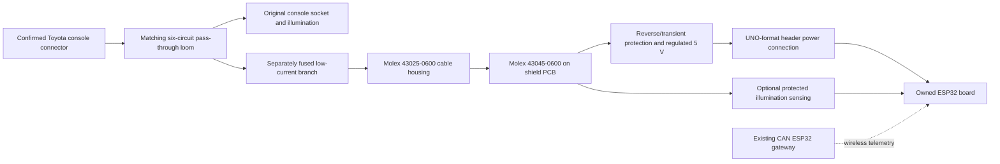

# Toyota console plug → ESP32 shield connection

Research date: 2026-11-07 local. **Draft connector selection and circuit mapping; no vehicle connection or PCB fabrication release.**

The leading identification is **IR1**, the six-cavity connection between the instrument-panel loom and cigarette-lighter sub-loom. The photographed loose white plug has not been seen from its mating face, so its identity, contact gender, keying and numbering remain unconfirmed.

## Concrete plug candidate

Toyota's **2003 EWD514U, printed pp. 52–53**, shows IR1 at this console location and draws both halves with two upper cavities and four lower cavities. This is the layout to compare with the vehicle. **Yazaki 7282-1060 / 7283-1060**, 2.3II/090II unsealed six-way, is a strong geometry candidate. This association is our inference from drawings, **not a factory 2005 IR1-to-part-number cross-reference**.

Yazaki explicitly lists these two housings as mates. Its male housing is 38.0 mm long × 21.1 mm wide × 21.4 mm high; the female is 22.0 × 18.7 × 17.0 mm. These are **wire-harness housings using crimp terminals**. No documented, orderable PCB-tail mate for this exact interface was established in this research. Do not treat a housing's “PCB model” download as a solderable PCB connector.

| Role | Part / purchase lead | Evidence status |
| --- | --- | --- |
| Candidate Toyota-side pin housing | **Yazaki 7282-1060**, Corsa **090IIU-6P-1** kit | Manufacturer mating pair confirmed; exact photo/2005 vehicle match pending. Supplier cross-reference: Toyota **90980-10796** |
| Candidate opposite socket housing for a pass-through loom | **Yazaki 7283-1060**, Corsa **090IIU-6S-1** kit | Manufacturer mating pair confirmed; supplier cross-reference includes Toyota **90980-10797**. Check exact keying/retainer revision |
| Small-wire male contact | **Yazaki 7114-4020** | Cataloged for 7282-1060; 0.30–0.50 mm² wire. Candidate for the new fused branch only |
| Matching small-wire female contact | **Yazaki 7116-5041-02** | Cataloged for 7283-1060 and mates with 7114-4020; 0.30–0.50 mm² AVSS/CAVS/CAVUS or 0.50 mm² AVS |
| New adapter cable end | **Molex 43025-0600**, six **43030-0007** sockets | Six-way Micro-Fit 3.0 receptacle; 20/22/24 AWG contacts, insulation OD ≤1.85 mm |
| Shield PCB connector J1 | **Molex 43045-0600** | Six-way, 3 mm pitch, right-angle through-hole PCB header; matches the Micro-Fit cable end |
| Shield-to-controller headers | **SparkFun PRT-11417** | UNO R3 kit: 2 × eight-pin, 1 × ten-pin, 1 × six-pin. Physical compatibility with the owned ESP32 revision still pending |

Corsa listed the pin kit at $3.14 and socket kit at $3.03 during retrieval; SparkFun listed its header kit at $2.75. These are dated page observations before delivery/tax, not quotes or guaranteed stock. Confirm the contact size included in a kit. **Do not use the small branch contacts/wire to replace the original lighter's full-current pass-through conductors.**

## Connection to the PCB on top of the controller

This satisfies the requested plug-in PCB arrangement with a **short adapter loom**. The Toyota crimp housing can be captured by a custom case bracket if desired; the PCB itself mounts on the controller's headers and screw supports. Support the cable/connector insertion force in the case. The bulky Toyota housing is not soldered directly to the shield.

The Micro-Fit and Toyota cavity arrangements differ. Assemble by **molded cavity numbers and continuity**, never by matching spatial positions, wire colors, or guessed front/rear views. `PINMAP-DRAFT.csv` is the numbered adapter proposal, conditional on confirming IR1 and its exact 2005 applicability.

## Six-circuit map — adjacent-year reference, not the vehicle pinout

The accessible factory **2006 EM00T0U** supplies this reference: overall diagram **printed p. 447** (PDF page 33), and cigarette-lighter system **printed pp. 296–297** (PDF pages 340–341). The exact 2005 manual is **EWD615U**, whose corresponding pages were not obtained. Do not relabel 2003/2006 data as verified 2005 V8 wiring.

| Candidate IR1 cavity | Factory 2006 circuit / wire | Proposed J1 cavity | Shield destination |
| --- | --- | --- | --- |
| 1 | Ashtray illumination feed, G (green) | 1 | Separate breakout/test point; optional protected sense later |
| 2 | Ashtray illumination return, W–G on main loom; W–B on lamp sub-loom | 2 | Separate breakout; **not tied to chassis/power ground** |
| 3 | Lighter illumination feed, G | 3 | Separate breakout/test point; optional protected sense later |
| 4 | Lighter illumination return, W–G on main loom; W–B on lamp sub-loom | 4 | Separate breakout; **not tied to chassis/power ground** |
| 5 | Lighter power ground, W–B | 5 | Power ground after confirmation |
| 6 | CIG accessory feed, P–L (pink/blue); drawing shows 10 A CIG upstream fuse | 6 | New branch fuse → protection → buck regulator |

Only cavities 5 and 6 would be needed to power a basic node after confirmation. Optional 1–4 provide lighting/dimmer observation with a designed input stage; **no raw vehicle voltage reaches GPIO**. Preserve all six original paths outside the PCB. An upstream 10 A factory fuse is not protection for this new small branch or Micro-Fit wiring. LED-load power needs its own reviewed current budget and fuse.

The documented IR1 circuits contain **no CAN-H/CAN-L pair**. Telemetry reaches this node from the existing gateway. BLE/Wi-Fi topology and GPIO allocation are separate firmware work.

## PCB footprint and UNO reference geometry

Use the official KiCad footprint `Connector_Molex:Molex_Micro-Fit_3.0_43045-0600_2x03_P3.00mm_Horizontal`, downloaded and hash-pinned in the pack. Relative to footprint pad 1, top-side layout coordinates are:

| Pad | X / Y mm |
| --- | --- |
| 1 / 2 / 3 | (0, 0) / (3, 0) / (6, 0) |
| 4 / 5 / 6 | (0, 3) / (3, 3) / (6, 3) |
| Retention hole | (3, −4.32), Ø3.0 mm non-plated |

The library uses Ø1.02 mm drills and 1.5 mm copper pads for the six contacts. Treat these as a library reference until compared with the selected manufacturer's current drawing and board stackup. Footprint coordinates are not the harness's mating-face view.

Official Arduino **A000066 UNO-TH_Rev3e.brd** was downloaded. `uno-r3-reference-header-coordinates.json` records its 32 header pad centers and four mounting holes in the original EAGLE millimeter coordinates. The two digital header groups have an **unusual 4.064 mm separation** between their adjacent pad centers; copying a uniform 2.54 mm grid will not fit. Opposite header rows are 48.26 mm apart. This is a reference for the proposed shield, **not proof that the owned ESP32 shares the holes, header locations, board height or USB/antenna keepouts**.

The likely DIYables UNO-format ESP32-S3 has 3.3 V GPIO despite UNO-shaped headers. Confirm the owned maker/revision before routing power or selecting GPIO. Keep the antenna region clear of shield copper, components and wiring using that exact module's guidance. Verify the regulated-5 V injection point and USB backfeed behavior from the actual board circuit before making the power connection.

## Downloaded CAD and native inspection

The pack contains **Yazaki's directly downloaded 7282-1060 STEP**, both manufacturer housing drawings, the existing Molex header/housing STEP references, the official KiCad footprint, and Arduino's original EAGLE CAD ZIP. Toyota reference manuals are retained privately with their real model years.

Orion job **mdl_d7b7711c712a454c** imported the three pinned STEP files without repair and generated a catalog preview. Yazaki imported as one valid solid with bounds **21.1 × 21.4 × 38.000003 mm**, matching the published envelope. Its tessellated mesh is **not closed**; retain it as reference CAD, not a printable Toyota connector. The Molex models are valid 7-solid / 1-solid references, previously sourced from public mirrors. The catalog is not a mated assembly or shield-fit verification.

Remaining release inputs are narrow: the target plug's straight-on mating face/molded number, its physical cavity map on the exact 2005 V8, and the owned ESP32 maker/revision. No part was ordered and no vehicle was connected.

## Sources

- [Toyota EWD514U routing, 2003; printed pp. 52–53](https://carmanualsclub.com/files/62abc497b1f970ed9bc95202d30583bf3a73aea30feba8fadbbcb2acc2d99169.pdf)
- [Toyota EM00T0U diagrams, 2006; printed p. 447 and pp. 296–297](https://www.datacar-manualrepair.com/wp-content/uploads/2018/09/Diagrama-el%C3%A9ctrico-Toyota-4Runner-2006.pdf)
- [Yazaki 7282-1060 manufacturer page](https://connector.yazaki-group.com/cgi-bin/english/detail.cgi?part_id=7282-1060), [matching 7283-1060](https://connector.yazaki-group.com/cgi-bin/english/detail.cgi?part_id=7283-1060)
- [Yazaki 7114-4020 contact](https://connector.yazaki-group.com/cgi-bin/english/detail.cgi?part_id=7114-4020), [7116-5041-02 contact](https://connector.yazaki-group.com/cgi-bin/english/detail.cgi?part_id=7116-5041-02)
- [Corsa pin kit / Toyota cross-reference](https://www.corsa-technic.com/item.php?item_id=1359), [socket kit / Toyota cross-reference](https://www.corsa-technic.com/item.php?item_id=1360)
- [Molex PCB header](https://www.molex.com/en-us/products/part-detail/430450600), [cable housing](https://www.molex.com/en-us/products/part-detail/430250600), [crimp sockets](https://www.molex.com/en-us/products/part-detail/430300007)
- [Official KiCad footprint](https://gitlab.com/kicad/libraries/kicad-footprints/-/raw/master/Connector_Molex.pretty/Molex_Micro-Fit_3.0_43045-0600_2x03_P3.00mm_Horizontal.kicad_mod)
- [SparkFun PRT-11417 headers](https://www.sparkfun.com/arduino-stackable-header-kit-r3.html), [Arduino UNO R3 official CAD](https://docs.arduino.cc/hardware/uno-rev3/)
- [DIYables prospective board](https://diyables.io/products/esp32-s3-development-board-with-esp32-s3-wroom-1-n16r8-wifi-bluetooth-uno-compatible-form-factor-works-with-arduino-ide)
