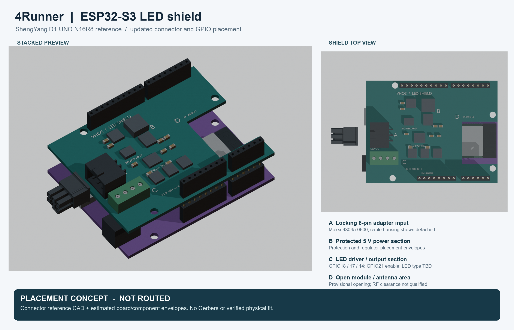

# Updated shield placement preview

This historical placement image is superseded by the [routed RGBW evaluation
and native KiCad preview](../pcb-rgbw-reva/README.md). Its original files and
receipts remain unchanged.

This picture answers the owner's request for an updated PCB view. It is a
**placement concept**, with no electrical routing, netlist, firmware or Gerbers.
The lower purple board is an estimated ShengYang D1 UNO ESP32-S3 layout using
nominal UNO header coordinates. The upper teal shield is our custom concept.

- A: downloaded Molex 43045-0600 PCB header and detached 43025-0600 cable housing.
- B: estimated protection and 5 V regulator component envelopes.
- C: estimated LED driver blocks and illustrative four-way output connector;
  LED type, connector rating and driver implementation remain unselected.
- D: a provisional cutout over part of the module/antenna area. No RF claim.

GPIO18/17/14 and GPIO21 follow the [recorded pin proposal](../controller-board/README.md).
No image label identifies an unknown Toyota cavity or releases a vehicle connection.
The photographed Toyota mating half remains a candidate requiring a face match.

## Geometry and evidence

The imported connector models and Espressif module reference retain their
recorded source quality and hashes. Module position, controller outline,
component bodies and populated/header height are estimates. Four nominal
mount holes come from the Arduino reference and are not verified ShengYang holes.
The 14.5 mm shield-bottom Z and 8.5 mm header-body envelopes are visualization
inputs, not a selected orderable stack height. Full insertion, extraction,
screw access, wire routing, vibration and RF/thermal checks remain outstanding.
The case and earlier CAD are unchanged.

The two board plates and all their nominal header holes are generated together.
The STEP export was reopened and found valid; all generated/imported native parts
were valid and 32 nominal header positions were recorded. This is geometry
validity evidence, not an installed fit or circuit check. No interference,
physical fit or manufacturing qualification is claimed.

The authenticated, source/input-pinned Orion job is `mdl_601003628bcb4aaf`.
Native FreeCAD generated the concept geometry; Blender rendered top/isometric
views; the image composition also ran on Orion. No cloud image generation,
GitHub Actions, printer action or vehicle connection was used.

Source and input hashes, job results and artifact hashes are under `evidence/`.
Retained local assets include STEP, FCStd, Blender source, separate PNG views and
this combined overview under `artifacts/4runner-updated-shield-preview-2026-11-07/`.
The imported third-party model files remain outside Git.
