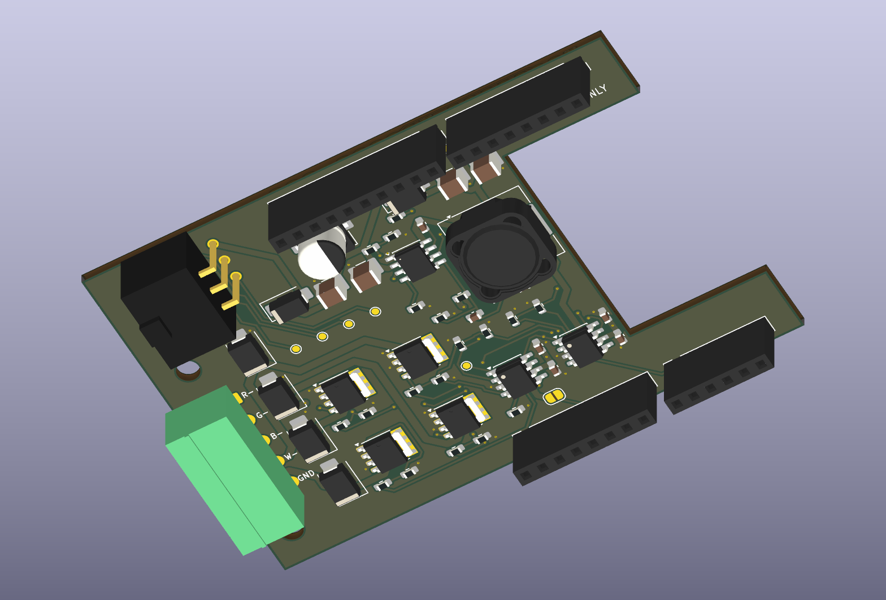

# RGBW shield Rev A — electrical and enclosure evaluation

Working target: four Diode Dynamics DD7440 RGBW pods in **one shared color
zone**, controlled by the owner's ShengYang UNO-format ESP32-S3. This is an
engineering assumption used to advance the draft; the light has not been
purchased or physically identified. Four independently colored pods would
require sixteen power channels or separate compatible drivers.



The current Orion export has **zero ERC findings, zero DRC findings, zero
unconnected items and zero schematic-parity findings**. All 153 connected pin
instances agree across the circuit definition, exported schematic netlist and
PCB. Thirty-two header positions match the nominal Arduino reference. Actual
copper widths pass the declared minima. See the [check receipt](evidence/final-verification.json),
[schematic PDF](generated/schematic.pdf), [native PCB](generated/vhos_rgbw_reva.kicad_pcb),
[BOM](generated/BOM-DRAFT.csv) and [mechanical observations](generated/mechanical-observation.json).

The exported STEP was reopened and checked against the revised case, lid,
carrier, estimated controller and sampled access corridors. These revised
checks have no volumetric interference. The comparison with the **original
42 mm body** deliberately records a 330 mm³ clash with the estimated plug;
the new 48 mm body provides 5 mm nominal plug-to-lid clearance. Three custom
printable parts export as valid single solids and closed STL meshes. This is
nominal CAD evidence, not a physical fit or electrical qualification.

The generator creates real KiCad schematic, PCB, project, netlist, component
library, BOM, connectivity reports and native 3D exports on Orion. Outputs are
evaluation artifacts. The Toyota cavity map, pod M8 pinout, exact controller
geometry, stack hardware, RF placement and vehicle electrical qualification
remain unresolved. No fabrication, vehicle connection or printing is released.

## Interfaces

| Interface | PCB assignment | Evidence boundary |
| --- | --- | --- |
| J1, Molex 43045-0600 | 1–4 isolated test pads, 5 board GND, 6 externally fused ACC | The inline harness populates J1-6 only. |
| J1 cable mate | 43025-0600 housing, one 43030-0007 socket | The socket goes in cavity 6. The six Toyota circuits pass through the inline loom. |
| J2, Phoenix Contact 1803303 | 1 R−, 2 G−, 3 B−, 4 W−, 5 dedicated shield GND | Dry-cabin, unsealed 3.81 mm connector with 1803604 cable mate. Verify the mapping to the pod M8 connector before attaching the loads. |
| LED common positive | Separate protected LED supply, outside this PCB | The 9–16 V pod range does not qualify a direct vehicle feed against transients. |
| H1 pad 3 / pad 4 / pad 8 | GPIO18 red / GPIO17 green / GPIO14 blue | Screenshot labels and nominal UNO positions; continuity still requires the actual board. |
| H4 pad 1 | GPIO2 white PWM | This revision uses A0 for white; the earlier optional illumination-sense proposal is superseded. |
| H2 pad 1 | GPIO21 driver enable | External 2.2 kΩ pulldown, four input pulldowns and four gate pulldowns establish intended hardware default-off behavior. |
| JP1 | OPEN by default: logic 5 V isolated from ESP32 5 V header | Close only after checking the actual board's power path, with USB physically disconnected. |

The [inline harness build sheet](../connector-adapter/INLINE-HARNESS.md) routes
the six original circuits outside the board and brings only verified, fused
switched positive to J1-6. J1-5 and J2-5 share a PCB ground net. Leave the J1-5
cable cavity empty and use J2-5 for both controller and LED return so the
factory console wiring cannot carry LED return current. The existing CAN
gateway supplies telemetry wirelessly.

## Circuit choices

The logic supply uses an LM5164-Q1 with a STPS2H100AY series diode, SMBJ24A input
clamp, Panasonic EEEFK1J100P bulk capacitor and Coilcraft MSS1246T-683MLC
inductor. Its evaluation target is **5 V / 0.5 A**, not the IC's full catalog
current rating. The nominal divider gives 5.000 V; RON 41.2 kΩ implies about
303 kHz. The UVLO divider gives approximately 8.29 V turn-on and 7.74 V turn-off
at the protected input, before diode and tolerance effects. Type-3 ripple
components follow the datasheet topology; startup, regulation, stability,
cable damping and actual biased capacitance still need bench measurements.

Two UCC27524A-Q1 drivers supply four 5 V gate outputs to four separate
BUK9Y15-60E LFPAK56 MOSFETs. The input high threshold is compatible with 3.3 V
GPIO. Driver enables have internal pullups, so the external pulldown is
intentional. Each channel has a 100 Ω gate resistor, 10 kΩ gate pulldown and
SMBJ24CA clamp candidate. The clamp's catalog pulse rating does not establish
protection against arbitrary cable faults or automotive load dump.

The **unqualified design limits** are 1.5 A per color and 3 A total at J2-5,
including the measured controller input current with the inline harness.
Via current, copper temperature, shared return continuity, solder joints,
connector heating and fault behavior require review before choosing load and
fuse ratings. Small resistor/capacitor manufacturer suffixes and the stacking
header hardware remain open in the BOM.

LED color tracks use a 1.0 mm minimum, power tracks 0.8 mm, and signal/logic
ground escapes 0.25 mm. Ground uses solid pad connections into copper pours on
both faces; the narrow logic escapes do not constitute a demonstrated 3 A
return path. The routed-width report measures actual imported copper, rather
than assuming that a netclass setting survived the interchange export.

## Geometry and evidence

The shield is 78.58 × 53.34 × 1.6 mm including its left mounting wing. Thirty-two
header centers are compared against the official Arduino UNO R3 EAGLE layout.
This verifies the reference coordinate transform; it does not establish that
the ShengYang board has the same geometry. Stock KiCad socket models have
short tails and are visualization references; they do not prove mating across
the proposed 15 mm board spacing. Select actual long-tail headers after
measuring the stack.

The right-hand PCB opening is provisional. Its dimensions do not demonstrate
the antenna clearance required by Espressif, and its position is based on a
photograph. Measure the actual board/module position before releasing the
outline. No RF performance claim is made.

The revised custom case, carrier and original lid interface are generated and
audited together. Native STEP solids are reopened before intersection checks
and STL meshing. The controller PCB, barrel jack, USB placement and harness
plug are labeled estimates; the module reference is manufacturer CAD at an
estimated placement. Installed, lid-removed driver access and straight unplug
corridors are sampled states, not a continuous service sweep. No FDM process,
insert pullout, screw torque, vibration, creep, thermal or sealing test has
been performed. Keep this open cabin enclosure inside the vehicle.

The revised body is **116 × 86 × 48 mm**, plus the retained 3 mm lid; ears make
the overall width 130 mm. The carrier is **90 × 62 × 2.4 mm**, with 15 mm shield
towers of 7 and 8 mm diameter. Tower centers derive from the actual exported
PCB mount coordinates. This revision proposes ten M3x5.7 inserts: four lid,
four carrier and two shield supports. Use four M3x8 lid screws, four M3x6 socket
screws without washers on the printed carrier, and two M3x6 shield screws with
0.5 mm insulating washers. Verify real head dimensions, insert stock, screw
engagement, tool access and process coupons before assembly. The lower tower
has only 1.2 mm nominal radial plastic around a 4.6 mm insert; strength and
heat-setting are unqualified. Actual controller underside parts and retention
are not modeled, so the nominal flat carrier contact is not an installation
instruction.

The [generated case models](generated/case/) are an unpowered fit-study
revision. Original case sources, CAD and their receipts remain unchanged.

`engineering-inputs.json` binds the reference assets and working dimensions.
`engineering_job.py` admits only source-pinned bounded evaluation requests.
All EDA, routing, rendering and native CAD execution belongs on Orion.
`orion_client.py` only stages sources, submits requests and checks downloaded
artifact sizes and SHA-256 hashes. Receipts preserve unsuccessful attempts;
a worker's successful exit alone is not a passed DRC or a fabrication release.

Current job: `mdl_3ccf5c4e62e84ff1`, source-set SHA-256
`25029bb9a81fa105229780fb70d00e5b40dbafd72781448c636327c758b8be7e`.
The full native output directory and assembled STEP/FCStd remain in the
workspace artifact pack; the Git directory retains our sources, selected native
electrical files, reports, previews and custom case parts. The downloaded
STEP/schematic text copies in Git trim trailing end-of-line spaces only;
the publication receipt records both native and published hashes, with every
geometry/connectivity token preserved. The full native archive is untouched.
The downloaded
Molex model's exact source/hash is recorded in the inputs and the earlier CAD
reference manifest. It is a community reference with unverified manufacturer
lineage. Put that model under `models/` beside the KiCad board when restoring
the complete 3D preview. No missing-model warning occurred in the final STEP
export. Stacking header models remain short-tail visualization references.

To verify the complete downloaded output without running CAD:

```sh
python3 verify_artifacts.py /path/to/full/output
```

For another owned-hardware build, place the four hash-pinned reference assets
in `inputs/`, configure the task-scoped authenticated Orion controller and
project directory, then use `orion_client.py submit UNIQUE-ID --stage finish`.
The client also recognizes the retained workspace reference locations. It
refuses missing or modified assets and refuses reusing a request identity.

## Primary references

- [TI LM5164-Q1 datasheet](https://www.ti.com/lit/ds/symlink/lm5164-q1.pdf)
- [TI UCC27524A-Q1 datasheet](https://www.ti.com/lit/ds/symlink/ucc27524a-q1.pdf)
- [Nexperia BUK9Y15-60E datasheet](https://assets.nexperia.com/documents/data-sheet/BUK9Y15-60E.pdf)
- [ST STPS2H100-Y datasheet](https://www.st.com/resource/en/datasheet/stps2h100-y.pdf)
- [Littelfuse SMBJ datasheet](https://www.littelfuse.com/~/media/electronics/datasheets/tvs_diodes/littelfuse_tvs_diode_smbj_datasheet.pdf.pdf)
- [Panasonic EEEFK1J100P specifications](https://industrial.panasonic.com/ww/products/pt/aluminum-cap-smd/models/EEEFK1J100P)
- [Coilcraft MSS1246T-683 specifications](https://www.coilcraft.com/en-us/products/power/shielded-inductors/ferrite-drum/mss-mos/mss1246t/mss1246t-683/)
- [Phoenix Contact 1803303 header](https://www.phoenixcontact.com/en-us/products/pcb-header-mc-15-5-g-381-1803303)
- [DD7440 product](https://www.diodedynamics.com/stage-series-rgbw-led-rock-light-one.html) and [compatible common-positive RGBW controller](https://www.diodedynamics.com/rgbw-bluetooth-controller.html)
- [KiCad 10 Specctra export implementation](https://github.com/KiCad/kicad-source-mirror/blob/10.0/pcbnew/specctra_import_export/specctra_export.cpp)

Manufacturer electrical facts and interface limits were reviewed November
7–8, 2026. Part choice and calculated nominal values do not establish testing
of the assembled board.
