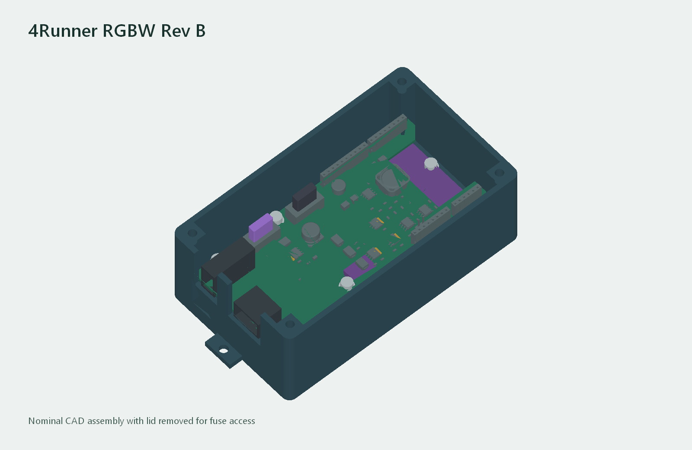
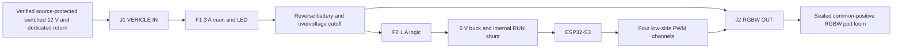

# Two-connector 4Runner RGBW shield and case

Rev B integrates the protected power path and both replaceable fuses onto
the RGBW shield. The shield stacks on the ShengYang D1 UNO ESP32-S3. Four
independent shield mounts carry plug and fuse handling loads into the base.
The assembled cabin box uses two latched cable plugs during operation.

| Prototype files | Contents |
| --- | --- |
| [Reinforced, support-free enclosure](DURABLE-CASE.md) | Stronger port and fastener geometry, matching base and lid, and process-specific fit coupons. |
| [Service-access enclosure](SERVICE-CASE.md) | Labeled cable openings, lighter nylon case, and CAD-checked insert and screw paths. |
| [JLCPCB quote package](jlcpcb/README.md) | Stocked parts, upload-ready BOM and placement files, assembly estimates, hand-assembly sources and revised SLS print files. |
| [KiCad project](generated/vhos_rgbw_revb.kicad_pro) · [schematic](generated/schematic.pdf) · [shield render](generated/shield.png) | PCB placement and routing, with local connector and fuse libraries. |
| [Gerbers and drills](generated/Prototype_PCB_Gerbers.zip) · [PCB BOM](generated/PCB-BOM.csv) · [SMT placement](generated/SMT-placement.csv) | Four-layer board plots, separate plated and non-plated drills, and top-side assembly data for a bench prototype. |
| [Corrected base](jlcpcb/print/case_base.stl) · [lid](jlcpcb/print/case_lid.stl) · [ports and inserts coupon](jlcpcb/print/ports_and_inserts_coupon.stl) · [Rev B reference assembly](generated/installed_assembly.FCStd) | Printable enclosure geometry with the updated insert pockets and the original editable stack reference. |
| [Digital verification](generated/verification.json) · [mechanical checks](generated/mechanical-observation.json) | KiCad findings, matched pins, closed meshes and assembly clearances. |

## Two cable connections

| Box port | PCB header and cable mate | Cavity assignments |
| --- | --- | --- |
| **J1 VEHICLE IN** | Molex Mega-Fit **76825-0002** and **171692-0102** | 1 dedicated chassis return, 2 verified switched +12 V. [Header](https://www.molex.com/en-us/products/part-detail/768250002) · [Housing](https://www.molex.com/en-us/products/part-detail/1716920102) |
| **J2 RGBW OUT** | Molex Micro-Fit **43045-0800** and **43025-0800** | 1 R−, 2 G−, 3 B−, 4 protected common +12 V, 5 W−. Leave 6–8 empty. [Header](https://www.molex.com/en-us/products/part-detail/0430450800) · [Housing](https://www.molex.com/en-us/products/part-detail/430250800) |

The latching plugs use different sizes. The port numbering belongs to Rev B.
Identify cable cavities with the connector drawings and confirm continuity
before inserting the terminals. The underbody end of the second cable uses
the LED maker's sealed connector. Determine the actual M8 functions with a
matched sample before terminating J2. R−, G−, B− and W− are individually
switched returns. Each pod must have the expected common-positive interface.

The [Toyota adapter](../connector-adapter/INLINE-HARNESS.md) provides the
pass-through pair. For Rev B, keep all six original Toyota paths continuous
and terminate the power takeoff and dedicated return in the new two-position
J1 cable housing. The truck feed must be switched, have measured headroom for
the entire box and light load, and have source protection sized to the cable
and terminals before the box. If the white plug supplies no usable feed,
use a verified switched outlet circuit with the correct adapter. The April
2005 4Runner owner's manual lists the CIG fuse position as unused. A custom
feed taken directly from the battery would require protection at its source.
[Toyota 2005 owner's manual, p. 408](https://assets.sia.toyota.com/publications/en/om-s/OM35860U/pdf/OM35860U.pdf#page=418).

## What goes inside

- **F1** uses a 3 A, 58 V Littelfuse MINI **0997003.WXN** element ahead of
  the protection stage. It protects the board and LED branch after the inlet.
  **F2** uses a 1 A Eaton **ATM-1** element on the protected 5 V converter
  input branch. Both fit vertical Keystone **3568** holders. The elements
  pull straight up with the screw lid removed. These values are prototype
  choices pending startup, ambient temperature and short-circuit testing.
  [Littelfuse 997](https://www.littelfuse.com/products/fuses-overcurrent-protection/fuses/automotive-fuses/blade-fuses-shunt/mini/997)
  · [Eaton ATM-1](https://www.eaton.com/us/en-us/skuPage.ATM-1.html)
  · [Keystone 3568](https://www.keyelco.com/product.cfm/product_id/306).
- **Input protection** uses a bidirectional TVS and TI LM74800-Q1 with two
  100 V common-drain MOSFETs. The divider nominally cuts the output near
  15.44 V and reconnects near 14.17 V. IC threshold spread, divider tolerance,
  leakage, overshoot and temperature require bench checks. The LM5164-Q1
  buck feeds the ESP32 from its regulated 5 V rail through the internal
  service shunt. The four gate channels default off through hardware pull-downs.
  [TI protection topology](https://www.ti.com/lit/ds/symlink/lm7480-q1.pdf#page=19)
  · [TI buck](https://www.ti.com/lit/ds/symlink/lm5164-q1.pdf).
- **Power budget** targets a 5 V / 0.5 A logic rail and up to 2 A continuous
  at the input for the first prototype, including controller and LEDs. The
  four DD7440 candidates form one zone. The supplier's 0.36 A at 13.2 V
  figure gives 1.44 A for four by arithmetic. Measure per-color and combined
  current at the actual load and cable length before choosing the installed
  quantity or confirming fuse coordination. The target and fuse values do
  not establish board ampacity, a load-dump rating, or a validated lamp load.
  [DD7440 specifications](https://www.diodedynamics.com/stage-series-rgbw-led-rock-light-one.html).

The PCB provides all internal electrical paths. The stack uses one SparkFun
PRT-11417 kit and the shield's onboard headers. The 5 V RUN shunt is installed
after verifying the lower board's actual power path. Remove the vehicle plug
and RUN shunt for USB programming. The case keeps the USB and barrel jack
inside. Vehicle-driven lighting still needs LED controller firmware and
integration with the wireless gateway and clients.
[Header kit](https://www.sparkfun.com/arduino-stackable-header-kit-r3.html).

## Assembly sequence

1. **Fit coupon and hardware.** Use the updated coupon to check both cable
   mates and all three heat-set boss types before printing the full case.
   Use the same material and finish for both prints. Measure the ESP32 board hole
   centers, header top height and underside solder clearance. Check the 15 mm
   board-to-board pitch, engagement of all four headers and antenna position.
2. **Print the base and lid.** The closed case is 132 × 76 × 49 mm before
   screw heads, or 146 mm across the mounting ears. The open-top connector
   slots let the shield lower into place. For a local FDM fit print, place
   the base on the floor and the lid on its exterior face. Confirm the heat-set fit
   and vehicle clearance around both cable exits. The lid covers the fuse
   pull paths during normal operation.
3. **Assemble the two-board stack.** Heat-set the M3 inserts. Fit the ESP32 to
   three lower bosses using insulating washers. The fourth boss supports the
   corner next to the digital header. Lower the shield onto the four
   headers, align its ports with the case slots, and fasten its four supports.
   Fit the fuse elements by their marked values. Leave the RUN shunt off at
   first. The [assembly BOM](ASSEMBLY-BOM.csv) includes the installed parts,
   both cable-side kits and the conditional vehicle/LED adapter parts.
4. **Bench bring-up.** Check fuse and connector continuity with power removed.
   Power J1 from a current-limited supply with the LED cable disconnected.
   Measure the 5 V rail at TP5 relative to TP6, the cutoff/recovery sweep and
   output-off behavior before installing the RUN shunt. Verify the exact ESP32
   5 V and USB behavior separately. Flash the firmware, verify that PWM is off
   on reset and communication loss, then check each color with a verified
   sample. Measure the final load, connector temperature and fuse behavior.
5. **Install in the cabin.** With key off, plug in **VEHICLE IN** and **RGBW
   OUT**. Check factory pass-through functions, then verify ACC startup,
   shutdown and lighting behavior. Support the looms at fixed cabin points
   and keep cable pull clear of the PCB. Verify the envelope against the
   intended console mounting position and cable bend space.

## Design and verification

[Engineering inputs](engineering-inputs.json) bind the port placement,
fuse-footprint geometry and case dimensions. [Design source](design.py)
reuses the routed Rev A logic and four PWM channel circuit, with the new
input cutoff, protected positive output and fuse holders. Orion generates
the KiCad files, printed parts and assembly and checks the reopened native
shapes. The PCB specification is 1.6 mm, four layers, 1 oz outer copper and
at least 0.5 oz inner copper, subject to assembly testing.
Use at least 1.60 mm finished plated holes at the two fuse holders. The
footprint calls for 1.70 mm nominal. [Keystone holder drawing](https://www.keyelco.com/product-pdf.cfm?p=306).

The case checks the nominal layout. Molex shells and fuse holders use
drawing-based envelopes, and the lower board geometry and cable latches use
fit reserves. The fit coupon and real stack measurements are needed before
the full case is used. Thermal, EMC, electrical fault and vehicle tests are
physical qualification steps.

Use `python3 -B orion_client.py start UNIQUE-ID --stage finish` to regenerate
on the existing authenticated Orion setup. Use `status`, `fetch` and `stop`
with the same identity. `fit` produces a placement and case pass for design
iteration. Confirm ERC, DRC and the mechanical report before using outputs.
