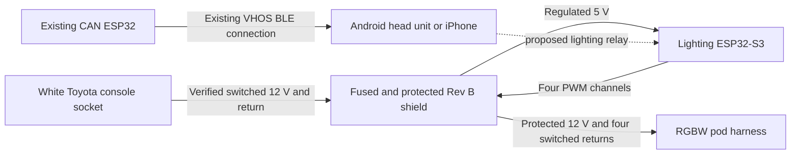

# Toyota-powered RGBW controller for the 2005 V8 4Runner

The cabin box uses the existing Rev B shield on the purple ShengYang D1 UNO
ESP32-S3. Its captive power lead is designed to mate with the white Toyota
console socket. Its captive lighting lead ends at the RGBW harness. The
existing CAN ESP32 supplies vehicle data wirelessly.
[Project resources and fabrication files](../RESOURCES.md).

## Power and lighting leads

The white vehicle connector resembles the six-way **Yazaki 7283-1060**
socket. The catalog pin mate is **Yazaki 7282-1060**, available as **Corsa
090IIU-6P-1** with terminals. This is a fit candidate until checked on the
truck. The design assumes the photographed socket is an available endpoint.
If it is normally connected to factory equipment, preserve all six factory
paths in a pass-through and take only the two verified power conductors.
[Yazaki pin mate](https://connector.yazaki-group.com/cgi-bin/english/detail.cgi?part_id=7282-1060) ·
[Corsa pin kit](https://www.corsa-technic.com/item.php?item_id=1359).

With the controller unplugged, use the molded cavity numbers and a
high-impedance meter to identify switched positive and a true power return.
Check OFF, ACC and ON, with console illumination both off and on. Verify the
upstream fuse and the available circuit current before loading the branch.
The 2006 IR1 drawing is reference evidence for another model year. Toyota's
April 2005 owner's manual lists the CIG fuse position as unused. If the
photographed socket lacks a verified switched feed and return, pause vehicle
connection at that socket. Confirm the socket's fuse and add protection close
to the takeoff if the original fuse is too large for the new branch wire.
[Toyota April 2005 owner's manual, p. 408](https://assets.sia.toyota.com/publications/en/om-s/OM35860U/pdf/OM35860U.pdf#page=418).

| Captive lead | Rev B plated termination pads |
| --- | --- |
| Toyota power | Pad 1 at the J1 location is verified power return. Pad 2 is verified switched 12 V. The original pad references locate the solder points. |
| RGBW lighting | Pads 1 to 5 at the J2 location are R−, G−, B−, protected common +12 V, and W−, in that order. Pads 6 to 8 stay empty. |

Leave the two removable board headers unpopulated and solder each lead to its
numbered plated pads. The power holes are 1.8 mm nominal. The lighting holes
are 1.02 mm nominal, so dry-fit the conductor and confirm the finished drill
and solder joint before installing a loom. For a bench lead, 18 AWG power and
20–22 AWG lighting conductors are candidates subject to hole fit and the actual
wire rating. Match the Yazaki crimp terminal to the power wire and insulation.
Make each wire long enough inside the box to leave a relaxed service loop.
The ties grip the sleeve so cable handling loads go into the case. Use the
actual pod sample to continuity-map the five-pin M8
lead before termination. Retain the molded underbody mate. The **DD7440** remains
the candidate pod, with one sample for the first bench check.
[DD7440 rock light](https://www.diodedynamics.com/stage-series-rgbw-led-rock-light-one.html) ·
[DD4083 and DD4084 five-pin M8 extension](https://www.diodedynamics.com/rgbw-m8-5-pin-extension-wire.html).

F1 is the existing 3 A MINI main/LED fuse and F2 is the 1 A logic fuse.
Both are in the box. Their values remain prototype selections. Confirm the
Toyota source headroom, upstream protection, fuse coordination and measured
load before installing the lights. For bench bring-up use a current-limited
supply and check the 5 V rail with the RUN shunt open first. Remove vehicle
power and the RUN shunt before USB programming.

## Existing CAN ESP32 integration

The identified source is the classic ESP32 with MrDIY CAN Shield v1.3+
target in **IsaiahDupree/4runner-vhos-firmware**. The pinned firmware
provides an encrypted, handshake-gated VHOS BLE stream with passive CAN
observations and supported diagnostic evidence. Its NimBLE configuration
permits one connected client. Use a head unit or iPhone as the active gateway
client and relay validated, fresh data or bounded lighting commands to the
lighting ESP32-S3. This relay is the proposed first integration. The vehicle
gateway and lighting transport still need an end-to-end bench check. Gate
the LED outputs off at boot, disconnect and stale input.
[Existing MrDIY target](https://github.com/IsaiahDupree/4runner-vhos-firmware/tree/a523483abc984a406c73659653571198e46b04a0/targets/mrdiy-esp32-v13) ·
[One-client BLE configuration](https://github.com/IsaiahDupree/4runner-vhos-firmware/blob/a523483abc984a406c73659653571198e46b04a0/targets/mrdiy-esp32-v13/sdkconfig.defaults#L22).

## Prototype fabrication and enclosure

Use the [Rev B four-layer Gerbers and drills](generated/Prototype_PCB_Gerbers.zip)
with the matching **SMT-only** [LM5169 BOM](jlcpcb/truck-lm5169-smt/BOM.csv)
and [placement file](jlcpcb/truck-lm5169-smt/CPL.csv). These files omit both
removable headers. The inductor, fuse holders, board stack headers, and RUN
jumper are fitted locally. The native KiCad evaluation retains the baseline
LM5164 circuit values. Build the lower-cost population using its matched
LM5169 BOM and placement files, including the four resistor changes.
[Parts list for the box and cables](TOYOTA-POWER-PARTS.csv).

The printed set has a matched [base](toyota-power-cad/case_base.stl) and
[lid](toyota-power-cad/case_lid.stl), a
[cable-saddle coupon](toyota-power-cad/front_ports_coupon.stl) with a
[matching lid slice](toyota-power-cad/front_lid_coupon.stl), and an
[M3 fit coupon](toyota-power-cad/m3_tolerance_coupon.stl). All five meshes
sliced with supports off at 0.20 mm layers and a 0.4 mm nozzle. The nominal
CAD passed 61 checks and all 11 insert and screw axes.
[Verification receipt](toyota-power-cad/verification.json).

Print the base floor-down and lid exterior-down. With the lid off, set the
sleeved wires into the top-open exits and thread two 2.5 mm heat-stabilized
ties through the printed saddles under each lead. The tie heads sit on
opposite sides of each saddle. Clamp the sleeve firmly and leave slack at the
solder joints. Check the fit coupon with the actual cable and ties. The
cabin case remains vented at the wire exits. Verify insert retention, cable
pull, fuse service, enclosure temperature and vibration on the built sample.
[Reference heat-stabilized tie](https://www.hellermanntyton.com/products/cable-ties-inside-serrated/t18r/111-01250).

Regenerate the support-free case and direct-lead KiCad/STEP evaluation on
Orion with `python3 -B orion_client.py start UNIQUE-ID --stage toyota-power-case`.
Use `status`, `fetch` and `stop` with the same job identity.
