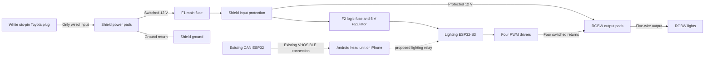

# Toyota-powered RGBW controller for the 2005 V8 4Runner

Use the [Rev D PCB and fabrication files](../pcb-rgbw-revd/README.md) for
new prototype boards. This build sheet records the earlier captive-lead
Rev B shield and the power path it shares with Rev D.

The white six-contact Toyota console harness in the owner's photos is the
only wired input to the box in service. Its switched 12 V and ground power
both the ShengYang D1 UNO ESP32-S3 and the RGBW lights through the Rev B
shield. The five-wire RGBW cable is an output from the shield to the lights.
The existing CAN ESP32 supplies vehicle data wirelessly.
[Project resources and fabrication files](../RESOURCES.md).

## Power and lighting leads

The white vehicle connector resembles the six-way **Yazaki 7283-1060**
socket. The catalog pin mate is **Yazaki 7282-1060**, available as **Corsa
090IIU-6P-1** with terminals. Verify the latch fit on the truck. The power
lead uses only the verified switched 12 V feed and power return. For an
unused factory socket, populate only those two cavities on the mating plug.
If the socket serves factory equipment, carry all six factory paths through
the inline harness and branch those same two conductors to the controller.
[Yazaki pin mate](https://connector.yazaki-group.com/cgi-bin/english/detail.cgi?part_id=7282-1060) ·
[Corsa pin kit](https://www.corsa-technic.com/item.php?item_id=1359).

With the controller unplugged, use the molded cavity numbers and a
high-impedance meter to identify switched positive and a true power return.
Check OFF, ACC and ON, with console illumination both off and on. Verify the
upstream fuse and the current available for the shield and the planned RGBW
load.
The 2006 IR1 drawing is reference evidence for another model year. Toyota's
April 2005 owner's manual lists the CIG fuse position as unused. If the
photographed socket lacks a verified switched feed and return, pause vehicle
connection at that socket. Confirm the socket's fuse and add protection close
to the takeoff if the original fuse is too large for the new branch wire.
[Toyota April 2005 owner's manual, p. 408](https://assets.sia.toyota.com/publications/en/om-s/OM35860U/pdf/OM35860U.pdf#page=418).

| Captive lead | Rev B plated termination pads |
| --- | --- |
| Toyota power input | Shield pad 1 at the J1 location takes the measured power return. Shield pad 2 takes the measured switched 12 V feed. Identify the Toyota cavity numbers on the truck. |
| RGBW lighting output | Pads 1 to 5 at the J2 location are R−, G−, B−, shield-supplied common +12 V, and W−, in that order. Pads 6 to 8 stay empty. |

Leave the two removable board headers unpopulated and solder each lead to its
numbered plated pads. The power holes are 1.8 mm nominal. The lighting holes
are 1.02 mm nominal, so dry-fit the conductor and confirm the finished drill
and solder joint before installing a loom. For a bench lead, 18 AWG power and
20–22 AWG lighting conductors are candidates subject to hole fit and the actual
wire rating. Match the Yazaki crimp terminal to the power wire and insulation.
Make each wire long enough inside the box to leave a relaxed service loop.
The ties grip the sleeve so cable handling loads go into the case. Use the
actual pod sample to continuity-map the five-pin M8
lead before termination. Retain the molded underbody mate. The **DD7440** remains
the candidate pod, with one sample for the first bench check.
[DD7440 rock light](https://www.diodedynamics.com/stage-series-rgbw-led-rock-light-one.html) ·
[DD4083 and DD4084 five-pin M8 extension](https://www.diodedynamics.com/rgbw-m8-5-pin-extension-wire.html).

The entire load passes through F1, the 3 A MINI main fuse. The protected
rail feeds the RGBW output directly and feeds the 5 V regulator through F2,
the 1 A logic fuse. Both fuse values are prototype selections. Confirm that
the Toyota circuit and its upstream protection can support the combined
controller and light load before connecting the system to the truck.

For bench bring-up, substitute a current-limited supply at the same power
input and check the 5 V rail with the RUN shunt open first. Disconnect input
power and remove the RUN shunt before USB programming.

## Existing CAN ESP32 integration

The identified source is the classic ESP32 with MrDIY CAN Shield v1.3+
target in **IsaiahDupree/4runner-vhos-firmware**. The pinned firmware
provides an encrypted, handshake-gated VHOS BLE stream with passive CAN
observations and supported diagnostic evidence. Its NimBLE configuration
permits one connected client. Use a head unit or iPhone as the active gateway
client and relay validated, fresh data or bounded lighting commands to the
lighting ESP32-S3. This relay is the proposed first integration. The vehicle
gateway and lighting transport still need an end-to-end bench check. Gate
the LED outputs off at boot, disconnect and stale input.
[Existing MrDIY target](https://github.com/IsaiahDupree/4runner-vhos-firmware/tree/a523483abc984a406c73659653571198e46b04a0/targets/mrdiy-esp32-v13) ·
[One-client BLE configuration](https://github.com/IsaiahDupree/4runner-vhos-firmware/blob/a523483abc984a406c73659653571198e46b04a0/targets/mrdiy-esp32-v13/sdkconfig.defaults#L22).

## Prototype fabrication and enclosure

Use the [Rev B four-layer Gerbers and drills](generated/Prototype_PCB_Gerbers.zip)
with the matching **SMT-only** [LM5169 BOM](jlcpcb/truck-lm5169-smt/BOM.csv)
and [placement file](jlcpcb/truck-lm5169-smt/CPL.csv). These files omit both
removable headers. The inductor, fuse holders, board stack headers, and RUN
jumper are fitted locally. The native KiCad evaluation retains the baseline
LM5164 circuit values. Build the lower-cost population using its matched
LM5169 BOM and placement files, including the four resistor changes.
[Parts list for the box and cables](TOYOTA-POWER-PARTS.csv).

The printed set has a matched [base](toyota-power-cad/case_base.stl) and
[lid](toyota-power-cad/case_lid.stl), a
[cable-saddle coupon](toyota-power-cad/front_ports_coupon.stl) with a
[matching lid slice](toyota-power-cad/front_lid_coupon.stl), and an
[M3 fit coupon](toyota-power-cad/m3_tolerance_coupon.stl). All five meshes
sliced with supports off at 0.20 mm layers and a 0.4 mm nozzle. The nominal
CAD passed 61 checks and all 11 insert and screw axes.
[Verification receipt](toyota-power-cad/verification.json).

Print the base floor-down and lid exterior-down. With the lid off, set the
sleeved wires into the top-open exits and thread two 2.5 mm heat-stabilized
ties through the printed saddles under each lead. The tie heads sit on
opposite sides of each saddle. Clamp the sleeve firmly and leave slack at the
solder joints. Check the fit coupon with the actual cable and ties. The
cabin case remains vented at the wire exits. Verify insert retention, cable
pull, fuse service, enclosure temperature and vibration on the built sample.
[Reference heat-stabilized tie](https://www.hellermanntyton.com/products/cable-ties-inside-serrated/t18r/111-01250).

Regenerate the support-free case and direct-lead KiCad/STEP evaluation on
Orion with `python3 -B orion_client.py start UNIQUE-ID --stage toyota-power-case`.
Use `status`, `fetch` and `stop` with the same job identity.
