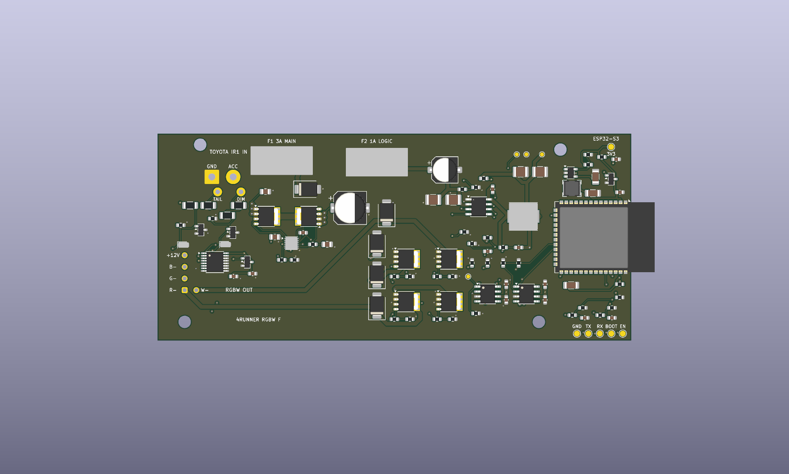
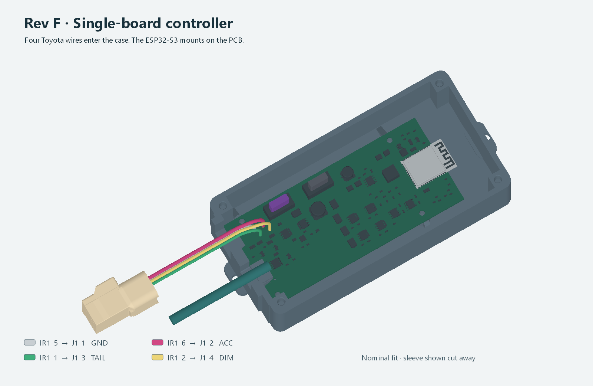

# Rev F single-board 4Runner RGBW controller

One four-layer PCB carries the ESP32-S3, automotive input-protection circuit,
two replaceable MINI fuses, TAIL and DIM sensing, and four RGBW drivers. The
2005 4Runner V8's six-pin Toyota IR1 loom provides switched 12 V and ground
through a single branch cable. The other cable goes to the RGBW pod. The
existing CAN ESP32 is the wireless telemetry source. The lighting firmware
and head-unit relay still need physical integration.
[IR1 factory diagrams](../connector-adapter/IR1-WIRE-PLAN.md) ·
[Pinned CAN gateway firmware](https://github.com/IsaiahDupree/4runner-vhos-firmware/tree/a523483abc984a406c73659653571198e46b04a0/targets/mrdiy-esp32-v13).

## Files

| Use | Files |
| --- | --- |
| PCB editing | [KiCad project](generated/vhos_rgbw_revf.kicad_pro) · [PCB](generated/vhos_rgbw_revf.kicad_pcb) · [Schematic](generated/vhos_rgbw_revf.kicad_sch) · [Schematic PDF](generated/schematic.pdf) |
| PCB fabrication and assembly pricing | [Gerbers and drills](generated/4Runner_RGBW_RevF_Gerbers.zip) · [JLCPCB BOM](jlcpcb/BOM.csv) · [JLCPCB CPL](jlcpcb/CPL.csv) · [Component costs and stock](jlcpcb/README.md) |
| PCB and enclosure CAD | [PCB STEP](generated/4Runner_RGBW_RevF_PCB.step) · [FreeCAD assembly](generated/4Runner_RevF_Assembly.FCStd) · [Toyota wire STEP](generated/4Runner_RevF_Toyota_Wires.step) |
| Case and fit coupons | [Base STL](generated/case_base.stl) · [Lid STL](generated/case_lid.stl) · [Cable entry](generated/front_ports_coupon.stl) · [Lid section](generated/front_lid_coupon.stl) · [M3 inserts](generated/m3_tolerance_coupon.stl) |
| Wiring and checks | [Wire register](WIRE-REGISTER.csv) · [Harness and case hardware](HARNESS-AND-CASE.csv) · [Verification](generated/verification.json) · [Bench test sequence](BENCH.md) |

## Wire register

| Toyota or board position | Installed on Rev F |
| --- | --- |
| IR1-5 white/black | J1-1 GND |
| IR1-6 pink/blue | J1-2 switched ACC through the 3 A main fuse |
| IR1-1 green | J1-3 TAIL to ESP32 GPIO5 through a protected sense circuit |
| IR1-2 white/green | J1-4 DIM to ESP32 GPIO4 through a protected sense circuit |
| IR1-3 green | Factory lighter ring circuit plus labeled, insulated TAIL reserve tail on the tee |
| IR1-4 white/green | Factory dimmer return plus labeled, insulated DIM reserve tail on the tee |
| J2-1 through J2-5 | R−, G−, B−, protected common +12 V, W− |

Wire the external tee 1:1 across all six cavities where the factory mate is
fitted. Keep the two capped reserve tails accessible outside the case. Verify
cavity numbers because the TAIL and DIM pairs share colors. Measure the actual
pod's five contacts and load before attaching it. The table numbers refer to
the PCB's J2 pads. [Connector face and meter checks](../connector-adapter/IR1-WIRE-PLAN.md#mating-face-reference).

## Power and programming

- F1 is **3 A, 58 V DC** on the main and LED feed. F2 is **1 A, 32 V DC**
  on the protected logic branch. LEDs draw from the protected vehicle feed.
  The LM5164-Q1 feeds the gate drivers and 3.3 V buck. The calculated startup
  threshold is 7.83–8.83 V at the protected buck input. An ACC feed that drops
  during cranking can reset the controller. [Rail and input calculations](generated/electrical-screen.json).
- The 3.3 V regulator targets 3.384 V. The ESP32 supervisor holds EN low until
  startup and on brownout. GPIO18, 17, 14 and 2 drive R, G, B and W. GPIO21
  enables the drivers. The TAIL/DIM inputs now use 18 kΩ ADC series resistors.
  Expect roughly 0.99 V at a settled 14.4 V input. Calibrate the actual divider
  and console dimmer waveform on the bench. [Sense and reset calculations](generated/electrical-screen.json).
- Flash with a 3.3 V logic UART while the truck and pod are unplugged and
  J1 is fed by a current-limited bench supply. TP9 is GND. TP10 TX connects to
  adapter RX and TP11 RX to adapter TX. Hold TP12 BOOT low and pulse TP13 EN
  low, then release EN before BOOT. TP14 measures 3.3 V. Leave the adapter's
  power wire disconnected. [Espressif download mode](https://docs.espressif.com/projects/esptool/en/latest/esp32s3/advanced-topics/boot-mode-selection.html).

## Fit and verification

The case measures 164 × 76 × 39.2 mm overall, including the mounting ears.
A 2.8 mm floor and four 2.3 mm lid recesses reduce solid CAD volume by
6.3% with 3.2 mm at the lid rim. The cable saddles, ribs and insert locations
are retained. The lid opens for fuse puller and probe access. For a JLC3DP
nylon print, quote the two STLs and check the sleeve and heat-set insert on
a coupon in the quoted process. The printer simulation uses the FLSUN V400
profile with supports disabled. [Case checks](generated/mechanical-observation.json) ·
[Cura slice receipt](generated/support-free.json) ·
[JLC3DP SLS nylon](https://jlc3dp.com/help/article/3201pa-f-nylon).

The TDK inductor, onsemi diodes and LM74800-Q1 use dimensioned maximum
envelopes in the 3D assembly. The inductor and diode footprints use their
manufacturer land patterns. KiCad verified zero ERC, DRC, unconnected and
schematic parity findings. FreeCAD passed 34 fit checks, 92 wire and
strain-relief checks, and eight screw and insert tool paths. Both case
pieces and all three coupons sliced with support generation off.
[TDK dimensions](https://product.tdk.com/en/system/files/dam/doc/product/inductor/inductor/smd/catalog/inductor_automotive_power_spm6545vt-d_en.pdf) ·
[onsemi CASE 477](https://www.onsemi.com/download/package-drawing/pdf/477-02.pdf) ·
[TI DRR0012E package](https://www.ti.com/lit/ds/symlink/lm7480-q1.pdf).

The parts and geometry are for an evaluation prototype. Bench power,
cold-pulse response, full LED load, actual inserts and sleeve retention,
RF range and installed Toyota fit are still to be measured.
[Bench sequence and acceptance points](BENCH.md).

Regenerate on Orion from [pcb-rgbw-revb](../pcb-rgbw-revb) with
`python3 -B orion_client.py start UNIQUE-ID --stage toyota-rev-f`.
Use `status`, `fetch` and `stop` with the same identity.
