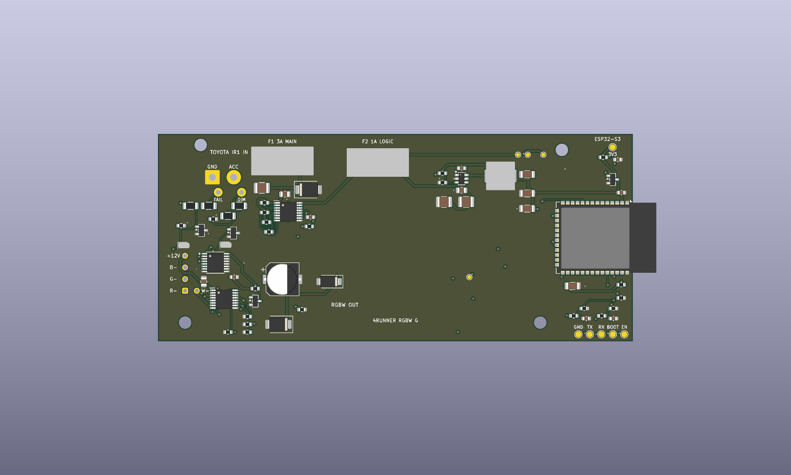
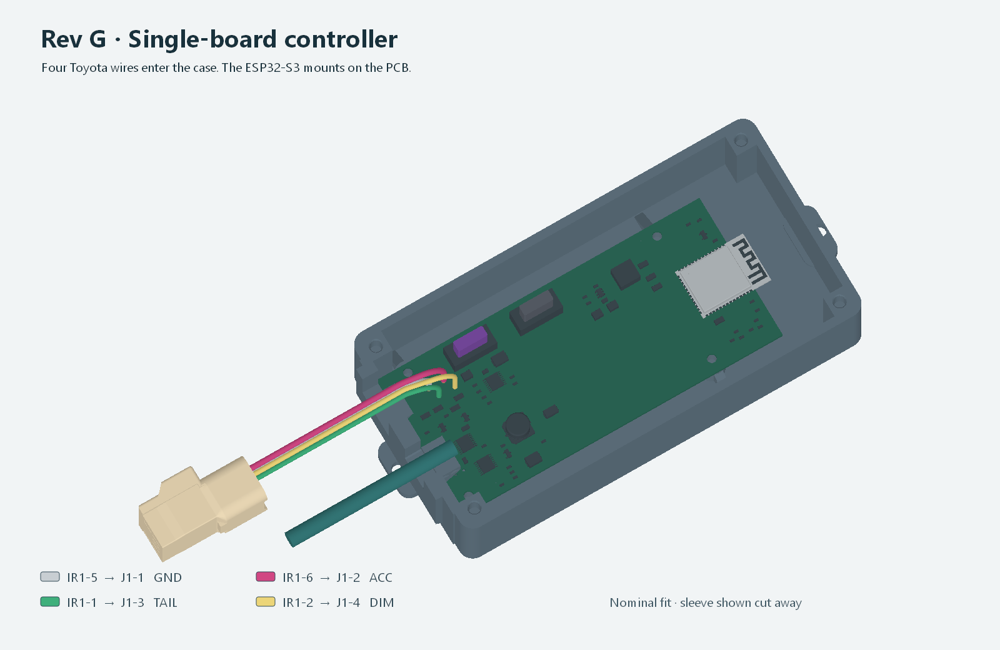

# Rev G single-board 4Runner RGBW controller

Rev G integrates the ESP32-S3, power protection, 3.3 V buck, illumination
sense and four low-side RGBW channels on one 122 × 53.34 mm four-layer
PCB for the 2005 4Runner V8. The enclosure has two captive cables.
The Toyota IR1 tee is the electrical input and supplies switched power,
ground, TAIL and DIM. The other cable drives one common-positive DD7440
RGBW pod. The existing CAN ESP32 supplies vehicle telemetry wirelessly.
[Factory wire plan](../connector-adapter/IR1-WIRE-PLAN.md) ·
[Pinned CAN gateway firmware](https://github.com/IsaiahDupree/4runner-vhos-firmware/tree/a523483abc984a406c73659653571198e46b04a0/targets/mrdiy-esp32-v13).

## Files

| Use | Files |
| --- | --- |
| Edit the PCB | [KiCad project](generated/vhos_rgbw_revg.kicad_pro) · [Board](generated/vhos_rgbw_revg.kicad_pcb) · [Schematic](generated/vhos_rgbw_revg.kicad_sch) · [Schematic PDF](generated/schematic.pdf) |
| Price fabrication and finished assembly | [Four-layer Gerbers and drills](generated/4Runner_RGBW_RevG_Gerbers.zip) · [Factory SMT and fuse-holder BOM](jlcpcb/factory-holders/BOM.csv) · [Matching CPL](jlcpcb/factory-holders/CPL.csv) · [Stock and pricing](jlcpcb/README.md) · [Finished-unit quote scope](BOX-BUILD.md) |
| Inspect the assembly | [PCB STEP](generated/4Runner_RGBW_RevG_PCB.step) · [FreeCAD assembly](generated/4Runner_RevG_Assembly.FCStd) · [Toyota lead STEP](generated/4Runner_RevG_Toyota_Wires.step) |
| Print the enclosure | [Base STL](generated/case_base.stl) · [Lid STL](generated/case_lid.stl) · [Cable-entry coupon](generated/front_ports_coupon.stl) · [Lid coupon](generated/front_lid_coupon.stl) · [M3 insert coupon](generated/m3_tolerance_coupon.stl) |
| Wire and test | [Six-cavity and RGBW register](WIRE-REGISTER.csv) · [Harness and case hardware](HARNESS-AND-CASE.csv) · [Digital test results](generated/verification.json) · [Bench procedure](BENCH.md) |

## Power, switching and wire assignments

- The TPS26600 eFuse protects the entire circuit behind F1 and uses a
  separate local RTN plane for reverse polarity protection. F1 is a
  3 A/58 V main fuse. F2 is a 1 A/32 V fuse feeding the LMR51610 direct
  3.3 V buck. The driver uses the protected vehicle rail. The nominal
  logic rail is 3.353 V. The calculated eFuse cutoff spans 14.94–15.86 V.
  [TI eFuse](https://www.ti.com/lit/ds/symlink/tps2660.pdf) ·
  [TI buck](https://www.ti.com/lit/ds/symlink/lmr51610.pdf) ·
  [Electrical screen](generated/electrical-screen.json).
- A DRV8803 supplies all four outputs. GPIO18, GPIO17, GPIO14 and GPIO2
  drive R, G, B and W. GPIO21 commands active-high enable through the
  inverting MOSFET. The modeled ceiling is 0.5 A per color and 1 A
  combined, at 10.5 V or above at J1, with 0.3 V allowed for copper and
  lead drop. Start with a single DD7440.
  [TI driver](https://www.ti.com/lit/ds/symlink/drv8803.pdf) ·
  [Diode Dynamics pod](https://www.diodedynamics.com/stage-series-rgbw-led-rock-light-one.html).
- Pass all six IR1 cavities through 1:1. IR1-5 is ground at J1-1 and
  IR1-6 is switched ACC at J1-2. IR1-1 TAIL lands at J1-3/GPIO5, and
  IR1-2 DIM at J1-4/GPIO4. Keep the capped IR1-3 and IR1-4 reserve tails
  outside the case. The supervisor holds the sense selector low during
  reset. The J2 board order is R−, G−, B−, common +12 V, W−. Meter the
  actual Toyota and pod cavities before attaching either device.
  [Connector face](../connector-adapter/IR1-WIRE-PLAN.md#mating-face-reference) ·
  [Native pad locations](generated/wiring-interfaces.json).
- The ESP32-S3-WROOM-1-N16R2 has 16 MB flash and 2 MB PSRAM. Launch
  the firmware with settings for that hardware. TP9 through TP14
  give UART and manual flashing access with an independently powered
  bench supply at J1. The Android/iOS relay is a firmware integration.
  [Service sequence](BENCH.md) ·
  [Espressif module datasheet](https://www.espressif.com/sites/default/files/documentation/esp32-s3-wroom-1_wroom-1u_datasheet_en.pdf).

## Enclosure

The 164 × 76 × 39.2 mm case keeps the checked mounting holes, cable
saddles, two fuse access paths, four lid inserts and four board inserts.
The STEP uses the KiCad TSSOP package envelope for the TI HTSSOP
drivers, exact TI land patterns, and the dimensioned TDK and onsemi
envelopes from Rev F. Check the actual sleeves, insert fit and placement
behind the trim with the included coupons.
[Reopened mechanical checks](generated/mechanical-observation.json) ·
[Wire-path checks](generated/ir1-wire-fit.json) ·
[Supports-off slice evidence](generated/support-free.json).

Rev G is an evaluation prototype. Physical power, LED load, startup
timing, transients, RF, connector fit and vehicle clearance still need
measurement. The enclosure CAD and KiCad results are listed in the
[test receipt](generated/verification.json).

Regenerate on Orion from [pcb-rgbw-revb](../pcb-rgbw-revb) with
`python3 -B orion_client.py start UNIQUE-ID --stage toyota-rev-g`.
Use `status`, `fetch` and `stop` with the same identity.
