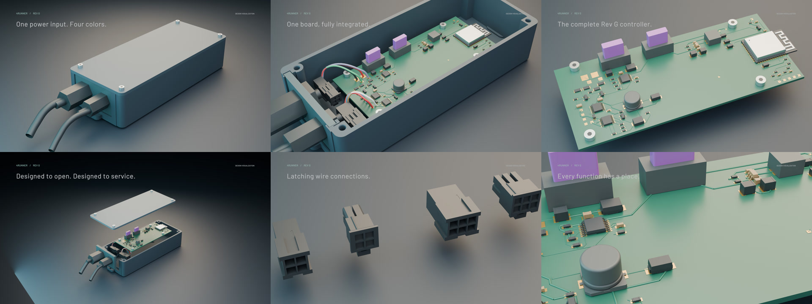

# Rev G product film and studio pictures

The studio pictures and narrated 3D film show the released gland enclosure,
the single populated board, its protection and sensing components, and the
planned service sequence. The video uses Isaiah Dupree’s registered
isaiah-qwen3-live-mic-v1 voice on owned Orion hardware.

[Full-resolution pictures](images) include the closed enclosure, installed
electronics, complete populated board, exploded assembly, four manufacturer
connector housings and a component close-up. These are CAD renders.

The pictures use Cycles and the film uses Eevee in Blender 4.4. Lighting and
materials are presentation choices. Component meshes come from the released
FreeCAD assembly. Pad and top-layer track positions come from the actual
KiCad board. The housing close-up uses the manufacturer’s Molex STEP files.
The wire loops and the placement of the Micro-Fit pairs illustrate routing
within the reserved service space. Mating alignment, latch access, actual
wire bends and physical fit require the prototype.

The exact script and chapter descriptions are in [storyboard.json](storyboard.json).
The narration uses Isaiah's saved native voice. It was generated on Orion;
the transcript and timing were checked before the movie was rendered.
The animated color indicators illustrate the control policy. They do not
represent measurements from a powered board.
The source reads the released [FreeCAD assembly](../glands/generated/4Runner_RevG_Gland_Assembly.FCStd)
and [KiCad board](../generated/vhos_rgbw_revg.kicad_pcb). It adds explanatory
lighting and animation to those files.

## Reproduction on Orion

The Mac stages source and input hashes and controls the private task lane.
Start [control_lane.py](control_lane.py) on Orion with the saved control token
file and a new task directory on its C drive. Use a private SSH tunnel for
127.0.0.1:8857. The lane exposes the existing typed narration and analysis
workers together with cad.revg_product_film.

The film job takes stage, expected_source_sha256 and timeout_sec.
Run export first. Stage its meshes.json.gz and board-details.json under
prepared. Run pictures for six studio views. Generate the chapter narration
through audio.isaiah_tts, retain its source and output receipts, and derive
the timeline from each WAV’s actual duration. Use the registered audio
speech-analysis project to obtain caption timestamps. Stage timeline.json,
captions.json and the accepted voice stems before running preview, then film.
Preview checks the first and last frames, chapter midpoints, and the
exploded-to-closed transition. The renderer checks projected assembly bounds
against its typography margins during the exploded and control chapters.
The final .blend files contain editable scene geometry and materials; the
Python source reproduces the camera and assembly animation.
The Blender presentation maps one source millimetre to 0.01 scene units for
lighting. Use the native CAD and STL files for dimensional fabrication.

The task lane has a bounded lifetime. Stop its exact PID and close its SSH
tunnel when finished. Keep the source, input and artifact hashes with the
published media.

## Components in the pictures

All 61 populated positions have geometry in the released assembly. The
silicon markings, fuse colors, solder finish and material textures in the
studio renders are illustrative. Use the [complete BOM](../generated/PCB-BOM.csv)
for exact ordering and the [factory assembly BOM](../jlcpcb/factory-holders/BOM.csv)
when requesting assembly. Stock and prices need a dated factory quote.

| Reference | Component | Function |
| --- | --- | --- |
| F1, F2 | Keystone 3568 holders with 3 A main and 1 A logic MINI elements | Replaceable branch protection |
| U4 | TPS26600PWPR | Electronic input protection |
| D1 | SMBJ28CAQ-13-F | Input transient clamp |
| U1, L1 | LMR51610XDBVR and TDK SPM6545VT-220M-D | 3.3 V switching supply |
| U11 | ESP32-S3-WROOM-1-N16R2 | Wireless processor |
| U2, Q1 | DRV8803PWPR and AO3400A | Four RGBW outputs and enable control |
| U5 | SN3257QPWRQ1 | Illumination-sense selector |
| U6, U7 | LM4040C25QFTA | Sense-input clamp references |
| U10 | TLV803EC30DBZR | Rail supervision |
| J1 wire disconnect | Molex 43020-0401 / 43025-0400 | Four active Toyota branch conductors |
| J2 wire disconnect | Molex 43020-0601 / 43025-0600 | Five RGBW conductors and an empty sixth cavity |

The Toyota connector remains a six-cavity inline tee outside the enclosure.
The controller has one vehicle power input. Two labeled reserve tails stay
capped outside the case. [Wire register](../WIRE-REGISTER.csv) ·
[Wire disconnect pin order](../glands/WIRE-DISCONNECTS.csv) ·
[CAD source provenance](cad-model-sources.json).

## Prototype validation

The underlying design records 62 additional service checks and the earlier
support-free print checks. The source repository includes the relay policy,
bench instructions and manufacturing files. Power, temperature, sealing,
actual connector fit and in-vehicle operation remain physical acceptance
steps. The rendered signal flow represents the intended behavior.
