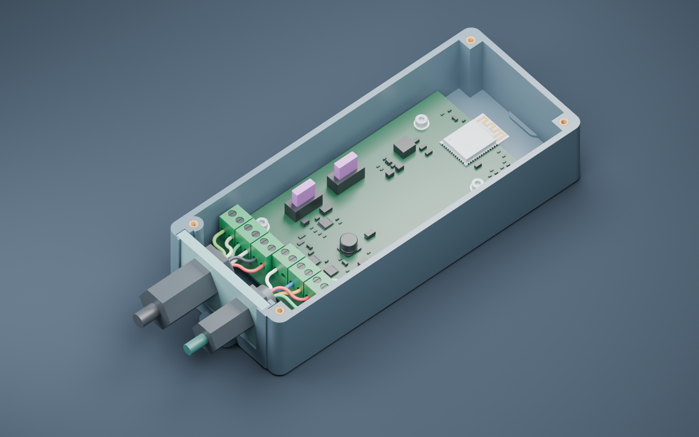

# Rev H: factory screw terminals

[Download the Rev H evaluation kit and Gerber ZIP](https://github.com/IsaiahDupree/4runner-vehicle-health-os/releases/tag/revh-terminals-2026-11-21).

[Complete product BOM and cost status](PRODUCT-BOM.md) · [Itemized BOM CSV](PRODUCT-BOM.csv).

The owner's latest lighting choice is **whole-strip analog RGB/RGBW**.
See the [automotive strip research and support screen](strips/README.md) for
manufacturer evidence, exact terminal mapping, load limits and the strip-build
BOM delta. No strip has yet passed complete component/physical qualification;
the existing PCB and renders must not be interpreted as approval for an
arbitrary length of automotive tape.

Rev H replaces the internal wire-pad pigtails and Micro-Fit pairs with six
factory-soldered two-position terminal blocks. There is one integrated board,
one Toyota six-wire power/sense inlet, and one RGBW outlet. CAN information
continues to arrive wirelessly from the existing gateway. The original
[Rev G film](https://www.youtube.com/watch?v=pL0iKmJQQIs) is an unlisted snapshot
of the earlier connector arrangement; it does not depict this revision.

The gland clamps the intact cable jacket. Inside, the jacket ends and the
individual conductors fan out to the front-facing terminal openings. Screws
are approached vertically with the lid removed. Custom rails support the PCB
under the terminal row, and the adjacent mounting pillar is strengthened.
The outer enclosure dimensions are retained. The bare PCB becomes 133 x 65 mm;
the existing power, driver and radio placements and antenna edge are retained.
The LED bank is staggered 3 mm to provide wire-bend space. D7 moves 3 mm;
MH1 moves to enclosure coordinates (45, 14) mm with an updated case pillar.

| Block | Position 1 | Position 2 |
|---|---|---|
| JT1 | GND: Toyota cavity 5 | ACC: Toyota cavity 6, sole power feed |
| JT2 | TAIL: Toyota cavity 1 | DIM: Toyota cavity 2 |
| JT3 | Toyota cavity 3, isolated reserve | Toyota cavity 4, isolated reserve |
| JT4 | R− | G− |
| JT5 | B− | Protected +LED |
| JT6 | W− | Empty isolated spare |

The factory harness retains a one-to-one pass-through at all six Toyota
cavities. Verify cavity orientation, voltages and polarity on the actual
truck. The two reserve terminals do not drive any circuitry. Never connect
them to ground or assume another power supply. The LED load screen remains
1 A combined and 0.5 A per channel.

The selected part is **KEFA KF128-5.08-2P-AA, JLCPCB C474952**. Its primary
[JLCPCB listing](https://jlcpcb.com/partdetail/C474952) identifies through-hole,
wave-solder assembly on Economic/Standard PCBA. The saved live catalog also
labels its assembly mode `manualWeld`; ask the factory to resolve this in the
quote. Both refer to supplier assembly, not customer soldering. The
[manufacturer page](https://www.kefaelectronic.com/KF128-5-0-5-08-PCB-Terminal-Block-pd46690974.html)
links the family drawing; its source URL and SHA-256 are retained in `references/`.

Six identical blocks add approximately **$1.16 per board in connector material**
at the captured 1–49 price tier. That excludes insertion/soldering and every
other assembly charge. One unique Extended SKU avoids introducing six
different connector SKUs. A finished, tested $100 unit remains a quote target,
not a verified price. The fresh [cost snapshot](COST.md) covers every current SKU: **$23.58** in nominal PCB component material. Fabrication, assembly, programming, fuses, cables, case, testing and delivery remain unquoted.

Use `jlcpcb/BOM.csv` and `CPL.csv` for a quote that includes **all 67 populated
positions**, including six terminal blocks and two fuse holders. Terminal CPL
centers are body centroids, with rotation 270 degrees; the factory must confirm
library orientation in its assembly viewer. Programming, fuses, harnesses and
case assembly are additional box-build operations. See `BOX-BUILD.md`.

`BUILD-CONTRACT.md` defines geometry, service states, evidence and pending
physical qualification. Native KiCad, CAD and print checks execute through the
source-pinned `terminal_job.py` on owned Orion. No cloud CI or rendering is used.
Generated files remain evaluation artifacts until the documented bench and
vehicle acceptance work is completed.

[Outside view](images/01-exterior.png) · [Bare board](images/03-board.png) · [Native routed board view](generated/board.png).

Digital validation: **232 software tests**, **52 valid contract schemas**, zero native KiCad ERC/DRC/unconnected/parity findings, **497 exported CAD and wire checks**, and three supports-off Cura slices with zero support segments. These results do not establish physical qualification. `generated/verification.json` binds native jobs, exact artifacts and runtime source hashes.
